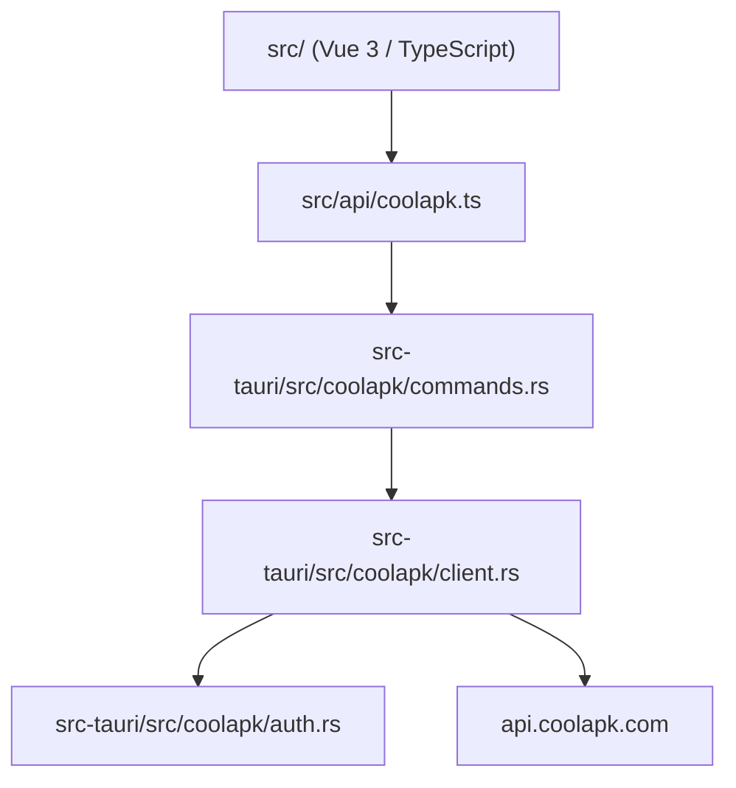

# daimiaopeng/coolapk-desktop

> Client non officiel de la communauté Coolapk, pour Windows, macOS, Linux, Android et iOS, basé sur Tauri.

## Le problème
Le réseau social chinois Coolapk n'a pas de client de bureau officiel. Ce projet en propose un, sans passer par le navigateur.

## Ce que ça fait vraiment
Affiche le fil d'actualité, les commentaires, l'historique, les favoris, la recherche et les messages privés de Coolapk. Le frontend est en Vue 3 et TypeScript, la couche native en Rust/Tauri 2, qui signe et envoie les requêtes vers api.coolapk.com. Plusieurs comptes sont gérés en local. Certaines fonctions peuvent casser si Coolapk change son API.

## Comment c'est branché
Schéma simplifié d'après la fiche, sans diagramme fourni.


## Essayer
```bash
git clone https://github.com/daimiaopeng/coolapk-desktop.git
cd coolapk-desktop
npm ci
npm run tauri dev
```

## Coût et pièges
Gratuit. Le dépôt est archivé : plus de correctif si l'API de Coolapk change. La compilation demande Node.js 22+, Rust stable et les dépendances système de Tauri 2 ; les paquets prêts à l'emploi sont sur GitHub Releases.

## Ce que ce n'est pas
Ce n'est pas un produit de Coolapk, qui n'a aucun lien avec le projet. L'IPA iOS n'est pas signé : il faut le re-signer soi-même.

## Alternatives
Aucune alternative nommée dans le README.

## Pour toi
À ignorer : client d'un réseau social chinois, archivé, sans rapport avec la data ou le MLOps.

