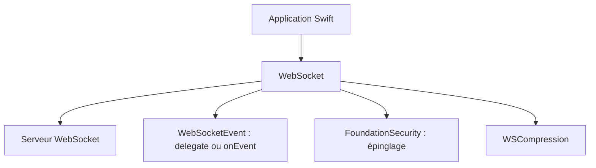

# daltoniam/Starscream

> Swift WebSocket library compliant with RFC 6455, for iOS and macOS applications.

## The problem
Apple applications need a reliable, non-blocking WebSocket client with TLS and compression.

## What it actually does
WebSocket client that passes the base Autobahn test suite, works in the background via GCD, handles TLS/WSS, compression (RFC 7692), certificate pinning, custom headers and a callback queue of your choice. Events arrive in a single enumeration. Pings automatically receive a pong.

## How it is wired
Simplified diagram based on the fiche, no diagram provided.



## Trying it
```bash
brew update
brew install carthage
```
```swift
.package(url: "https://github.com/daltoniam/Starscream.git", from: "4.0.6")
```

## Cost and gotchas
Free. Last push on 2024-05-16, 172 open issues. The README still lists to-dos: proxy support, thread-safe implementation, better tests.

## What it is not
It is not a cross-platform library: iOS 8 or macOS 10.10 and later. It does not handle proxies yet. The pinning documentation is marked as to be completed.

## Alternatives
No alternative named in the README.

## For you
Ignore: Swift library for Apple applications, not very active since 2024, outside your data / AI scope.
