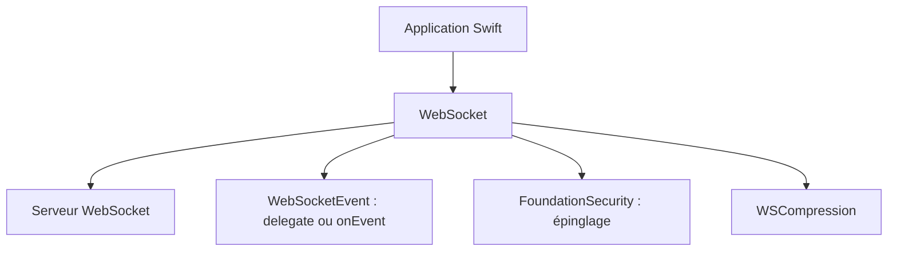

# daltoniam/Starscream

> Bibliothèque WebSocket en Swift conforme à la RFC 6455, pour applications iOS et macOS.

## Le problème
Les applications Apple ont besoin d'un client WebSocket fiable, non bloquant, avec TLS et compression.

## Ce que ça fait vraiment
Client WebSocket qui passe la suite de tests Autobahn de base, travaille en tâche de fond via GCD, gère TLS/WSS, la compression (RFC 7692), l'épinglage de certificats, les en-têtes personnalisés et une file de rappel au choix. Les événements arrivent dans une énumération unique. Les pings reçoivent automatiquement un pong.

## Comment c'est branché
Schéma simplifié d'après la fiche, sans diagramme fourni.



## Essayer
```bash
brew update
brew install carthage
```
```swift
.package(url: "https://github.com/daltoniam/Starscream.git", from: "4.0.6")
```

## Coût et pièges
Gratuit. Dernier push le 2024-05-16, 172 issues ouvertes. Le README liste encore des tâches à faire : prise en charge de proxy, implémentation sûre pour les threads, meilleurs tests.

## Ce que ce n'est pas
Ce n'est pas une bibliothèque multiplateforme : iOS 8 ou macOS 10.10 et plus. Elle ne gère pas encore les proxys. La documentation d'épinglage est marquée comme à compléter.

## Alternatives
Aucune alternative nommée dans le README.

## Pour toi
À ignorer : bibliothèque Swift pour applications Apple, peu active depuis 2024, hors de ton périmètre data / IA.

