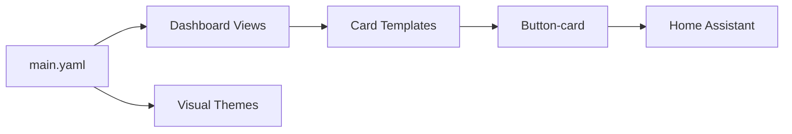

# damianeickhoff/HaCasa

> Former minimalist Home Assistant dashboard, archived, built with Button-card.

## The problem
The default Home Assistant dashboards are unpolished and painful to customise for a household.

## What it actually does
The repository contains a dashboard configuration (`main.yaml`), views, Button-card card templates, themes and images. The author aimed for a sober, customisable interface acceptable to the whole household. No installation command is documented.

## How it is wired

## Trying it
No command documented in the README.

## Cost and gotchas
Free, but archived: no updates, no issues or PRs accepted. Assumes a Home Assistant instance and Button-card.

## What it is not
Not maintained, and unrelated to data or AI. The README serves as the project's memorial.

## Alternatives
Button-card (RomRaider): the base on which the cards are built.

## For you
Ignore: archived repository and outside your data/AI/MLOps profile; it would only serve as inspiration for Home Assistant.
