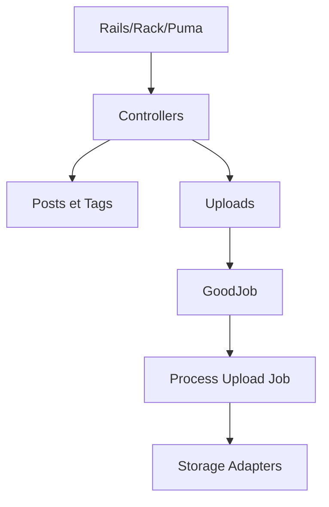

# danbooru/danbooru

> Rails application for a tag-based media archive, with uploads, search and moderation.

## The problem
Managing a large database of tagged images requires tag search, versioning, permissions and media processing.

## What it actually does
Posts, media, tags, aliases, pools, comments, votes and reports. Uploads are processed in the background (GoodJob): metadata, images, videos, ugoira. Storage is local, mirrored, rclone or SFTP. A dedicated search grammar. Optional services: IQDB, Reportbooru, recommendations, BigQuery, AWS SQS.

## How it is wired
Diagram based on the code diagram.



## Trying it
```bash
sh -c "$(curl -sSL https://raw.githubusercontent.com/danbooru/danbooru/master/bin/setup)"
# ou
git clone http://github.com/danbooru/danbooru
cd danbooru
touch .env.local config/danbooru_local_config.rb
sudo docker compose up
```

## Cost and gotchas
Free, Docker Compose recommended (manual installation discouraged). Several external microservices (IQDB, archives, SQS). License present but not identified by GitHub. The install script should be read before running it.

## What it is not
Not a lightweight tool: it is a full platform with a community and moderation to manage.

## Alternatives
No alternative named in the README.

## For you
Ignore: useful only as an example of a large Rails application or if you are building your own gallery site.
