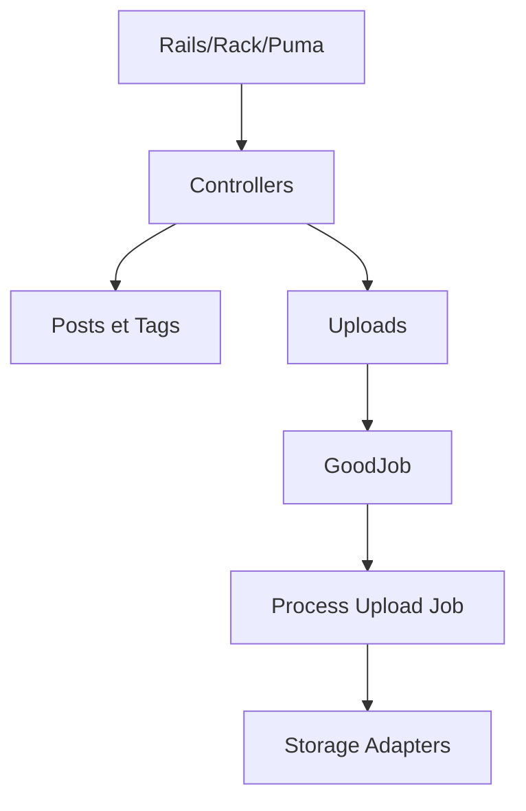

# danbooru/danbooru

> Application Rails d'archive de médias par étiquettes, avec téléversement, recherche et modération.

## Le problème
Gérer une grande base d'images étiquetées demande recherche par tags, versions, droits et traitement des médias.

## Ce que ça fait vraiment
Posts, médias, tags, alias, pools, commentaires, votes et signalements. Les téléversements sont traités en tâche de fond (GoodJob) : métadonnées, images, vidéos, ugoira. Stockage local, miroir, rclone ou SFTP. Une grammaire de recherche dédiée. Services optionnels : IQDB, Reportbooru, recommandations, BigQuery, AWS SQS.

## Comment c'est branché
Schéma d'après le diagramme du code.



## Essayer
```bash
sh -c "$(curl -sSL https://raw.githubusercontent.com/danbooru/danbooru/master/bin/setup)"
# ou
git clone http://github.com/danbooru/danbooru
cd danbooru
touch .env.local config/danbooru_local_config.rb
sudo docker compose up
```

## Coût et pièges
Gratuit, Docker Compose recommandé (installation manuelle déconseillée). Plusieurs microservices externes (IQDB, archives, SQS). Licence présente mais non identifiée par GitHub. Le script d'installation est à lire avant exécution.

## Ce que ce n'est pas
Pas un outil léger : c'est une plateforme complète avec communauté et modération à gérer.

## Alternatives
Aucune alternative nommée dans le README.

## Pour toi
À ignorer : utile seulement comme exemple de grosse application Rails ou si tu montes ton propre site de galerie.

