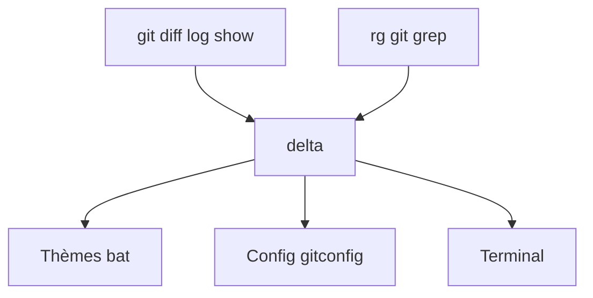

# dandavison/delta

> Syntax-highlighting pager for git, diff and grep, for anyone who reads a lot of diffs.

## The problem
Default git diffs are dull, with no per-language highlighting and no emphasis on changed words.

## What it actually does
Plugs into `~/.gitconfig` as `core.pager`. Highlights by language with bat themes, marks differences at the word level, offers a side-by-side view, line numbering, `n`/`N` navigation, and improved display of merge conflicts and `git blame`. It also colours the output of `rg` and `git grep`.

## How it is wired
Simplified diagram based on the sheet, no diagram provided.



## Trying it
```bash
git config --global core.pager delta
git config --global interactive.diffFilter 'delta --color-only'
git config --global delta.navigate true
git config --global delta.dark true
git config --global merge.conflictStyle zdiff3
delta --show-syntax-themes --dark
```

## Cost and gotchas
Free. The package is called `git-delta` in most package managers, the executable remains `delta`. You have to edit the git configuration.

## What it is not
Not a code review tool or a graphical interface: it only changes the display. It does not replace git.

## Alternatives
No alternative named in the README, apart from the `diff-highlight` and `diff-so-fancy` emulation modes.

## For you
Adopt: five lines of config make every notebook or code diff more readable, at zero installation cost.
