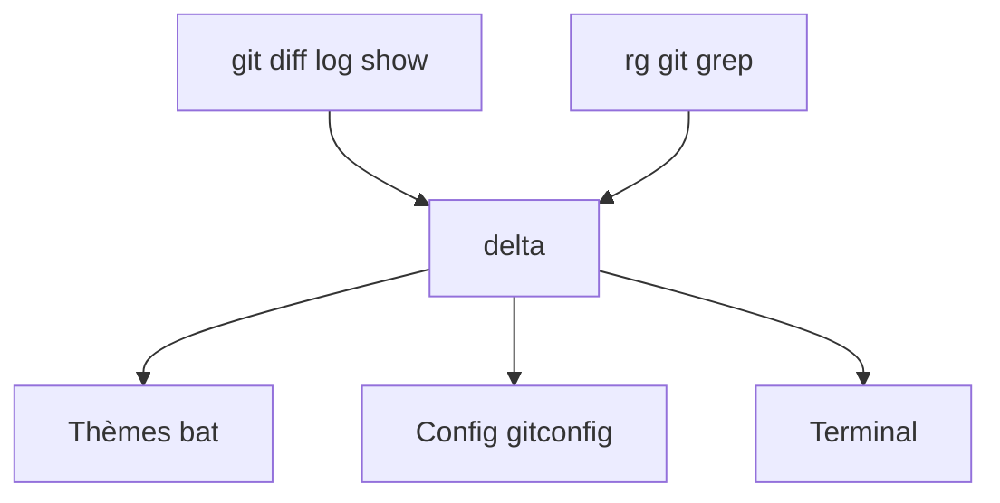

# dandavison/delta

> Pager à coloration syntaxique pour git, diff et grep, pour qui lit beaucoup de diffs.

## Le problème
Les diffs git par défaut sont ternes, sans coloration par langage ni mise en évidence des mots modifiés.

## Ce que ça fait vraiment
S'insère dans `~/.gitconfig` comme `core.pager`. Colore par langage avec les thèmes de bat, surligne les différences au niveau du mot, propose une vue côte à côte, la numérotation des lignes, la navigation `n`/`N`, et un affichage amélioré des conflits de merge et de `git blame`. Colore aussi la sortie de `rg` et `git grep`.

## Comment c'est branché
Schéma simplifié d'après la fiche, sans diagramme fourni.



## Essayer
```bash
git config --global core.pager delta
git config --global interactive.diffFilter 'delta --color-only'
git config --global delta.navigate true
git config --global delta.dark true
git config --global merge.conflictStyle zdiff3
delta --show-syntax-themes --dark
```

## Coût et pièges
Gratuit. Le paquet s'appelle `git-delta` dans la plupart des gestionnaires, l'exécutable reste `delta`. Il faut éditer la configuration git.

## Ce que ce n'est pas
Ce n'est pas un outil de revue de code ni une interface graphique : il ne change que l'affichage. Il ne remplace pas git.

## Alternatives
Aucune alternative nommée dans le README, hormis les modes d'émulation `diff-highlight` et `diff-so-fancy`.

## Pour toi
À adopter : cinq lignes de config rendent chaque diff de notebook ou de code plus lisible, pour un coût nul à l'installation.

