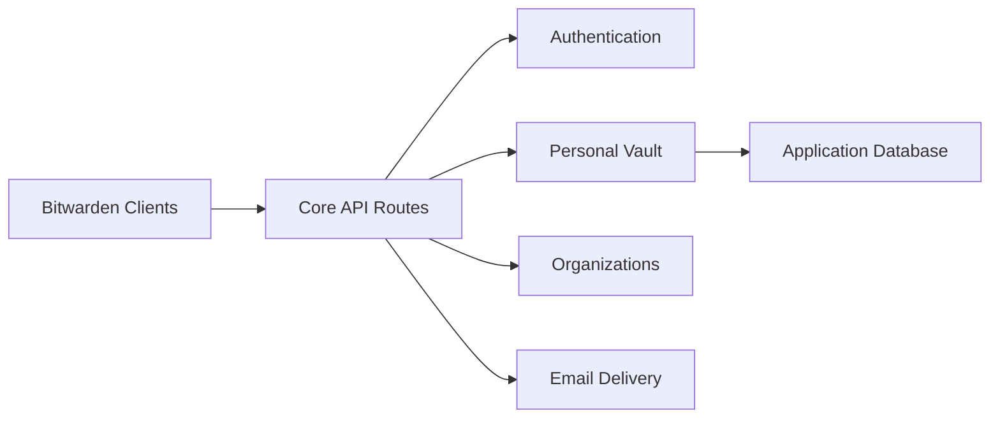

# dani-garcia/vaultwarden

> A server compatible with Bitwarden clients, written in Rust, for self-hosting your passwords.

## The problem
The official Bitwarden server is resource-intensive to host for an individual or a small organization.

## What it actually does
Implements almost the entire Bitwarden client API: personal vault, Send, attachments, organizations and collections, two-factor authentication (TOTP, email, WebAuthn, YubiKey, Duo), emergency access, administration interface. Optional: Rocket routes, database, SMTP, and push notifications.

## How it is wired


## Trying it
```shell
docker pull vaultwarden/server:latest
docker run --detach --name vaultwarden \
  --env DOMAIN="https://vw.domain.tld" \
  --volume /vw-data/:/data/ \
  --restart unless-stopped \
  --publish 127.0.0.1:8000:80 \
  vaultwarden/server:latest
```

## Cost and gotchas
Free of charge. HTTPS is required for the web storage (secure environment), and the use of a reverse proxy is recommended. You are responsible for your own backups: the project declines any responsibility in the event of data loss.

## What it is not
This is not a Bitwarden product: the README instructs users not to contact official support. One of the maintainers is employed by Bitwarden, in an independent capacity.

## Alternatives
The official Bitwarden server, which is heavier in terms of resources.

## For you
Suitable for a lightweight, self-hosted secret management solution, provided that it handles HTTPS and backups.
