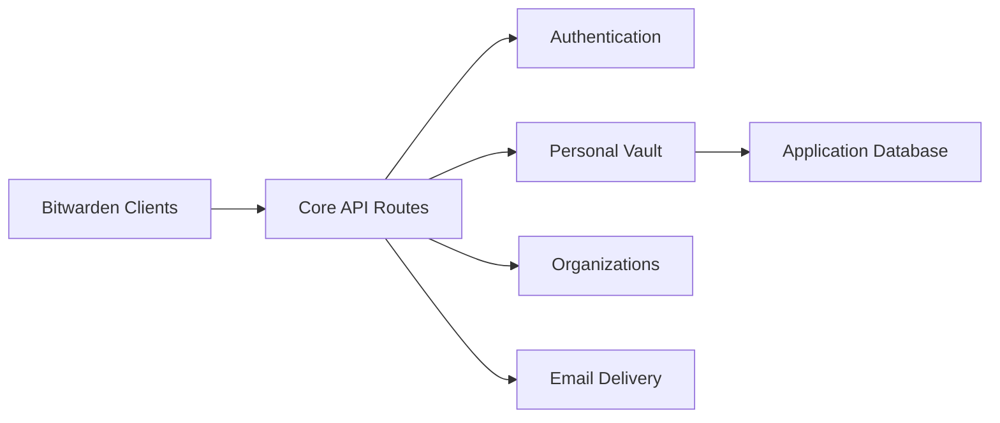

# dani-garcia/vaultwarden

> Serveur compatible avec les clients Bitwarden, écrit en Rust, pour héberger soi-même ses mots de passe.

## Le problème
Le serveur Bitwarden officiel est lourd à héberger pour un particulier ou une petite organisation.

## Ce que ça fait vraiment
Implémente presque toute l'API des clients Bitwarden : coffre personnel, Send, pièces jointes, organisations et collections, double authentification (TOTP, e-mail, WebAuthn, YubiKey, Duo), accès d'urgence, interface d'administration. Routes Rocket, base de données, SMTP et notifications push optionnels.

## Comment c'est branché


## Essayer
```shell
docker pull vaultwarden/server:latest
docker run --detach --name vaultwarden \
  --env DOMAIN="https://vw.domain.tld" \
  --volume /vw-data/:/data/ \
  --restart unless-stopped \
  --publish 127.0.0.1:8000:80 \
  vaultwarden/server:latest
```

## Coût et pièges
Gratuit. HTTPS obligatoire pour le coffre web (contexte sécurisé), avec un proxy inverse conseillé. Les sauvegardes sont ta responsabilité : le projet décline toute responsabilité en cas de perte de données.

## Ce que ce n'est pas
Pas un produit Bitwarden : le README demande de ne pas contacter le support officiel. Un des mainteneurs est employé par Bitwarden, à titre indépendant.

## Alternatives
Le serveur officiel Bitwarden, plus lourd.

## Pour toi
À adopter pour un gestionnaire de secrets auto-hébergé léger, à condition de gérer HTTPS et sauvegardes.

