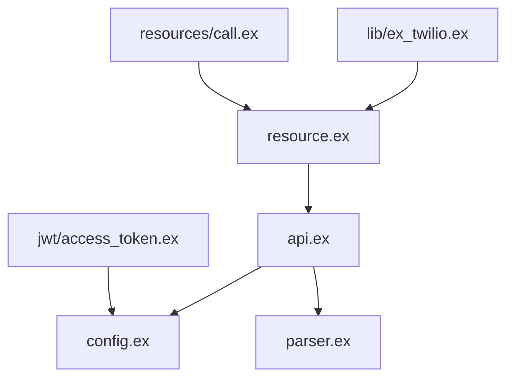

# danielberkompas/ex_twilio

> Elixir client for the Twilio API: calls, SMS and TaskRouter.

## The problem
Calling Twilio's REST API from Elixir requires handling authentication, pagination and response parsing.

## What it actually does
One module per Twilio resource (`ExTwilio.Call`, `Message`, `Recording`...) offers `all`, `stream`, `find`, `create`, `update` and `destroy` depending on the API. Credentials come from configuration or environment variables. It also provides JWT tokens and a request validator.

## How it is wired
Diagram based on the code diagram.


## Trying it
```bash
mix deps.get
```
Dependency: `{:ex_twilio, "~> 0.10.0"}`; variables `TWILIO_ACCOUNT_SID` and `TWILIO_AUTH_TOKEN`.

## Cost and gotchas
Free, but Twilio is pay-per-use: account and tokens are at your expense. The README calls itself beta, last push in April 2024. `all` blocks until the last page.

## What it is not
It is not an official Twilio SDK. It only covers the resources the repository has modeled.

## Alternatives
No alternative named in the README.

## For you
Ignore: a little-maintained Elixir client for a telephony service, outside the data and MLOps scope.
