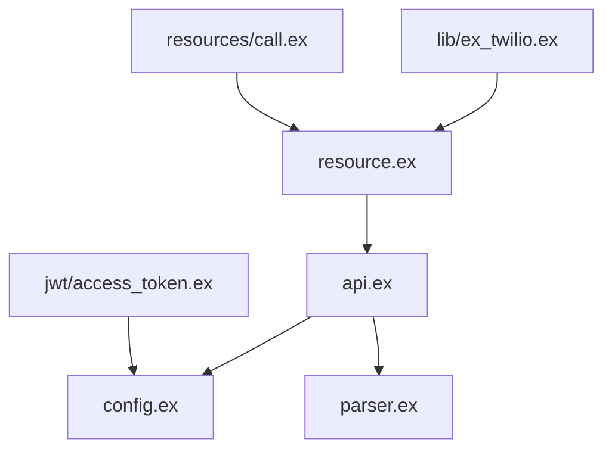

# danielberkompas/ex_twilio

> Client Elixir pour l'API Twilio : appels, SMS et TaskRouter.

## Le problème
Appeler l'API REST de Twilio depuis Elixir demande de gérer authentification, pagination et analyse des réponses.

## Ce que ça fait vraiment
Un module par ressource Twilio (`ExTwilio.Call`, `Message`, `Recording`…) offre `all`, `stream`, `find`, `create`, `update` et `destroy` selon l'API. Les identifiants viennent de la configuration ou de variables d'environnement. Il fournit aussi des jetons JWT et un validateur de requêtes.

## Comment c'est branché
Schéma d'après le diagramme du code.


## Essayer
```bash
mix deps.get
```
Dépendance : `{:ex_twilio, "~> 0.10.0"}` ; variables `TWILIO_ACCOUNT_SID` et `TWILIO_AUTH_TOKEN`.

## Coût et pièges
Gratuit, mais Twilio est payant à l'usage : compte et jetons à ta charge. Le README se dit bêta, dernier push en avril 2024. `all` bloque jusqu'à la dernière page.

## Ce que ce n'est pas
Ce n'est pas un SDK officiel de Twilio. Il ne couvre que les ressources que le dépôt a modélisées.

## Alternatives
Aucune alternative nommée dans le README.

## Pour toi
À ignorer : client Elixir peu suivi pour un service de téléphonie, hors du champ data et MLOps.

