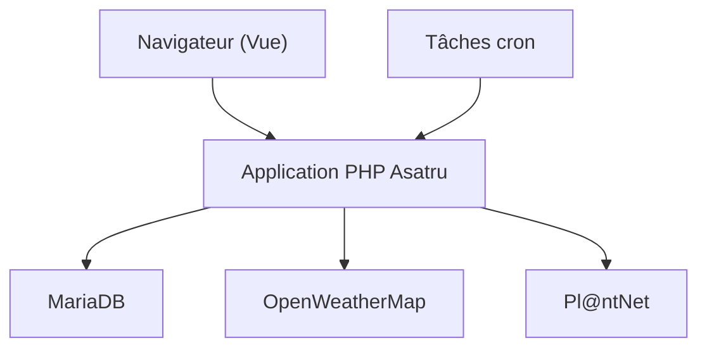

# danielbrendel/hortusfox-web

> Self-hosted web application for collaborative plant management, for gardeners and collectives.

## The problem
Tracking watering, photos and tasks for many plants across several locations quickly gets scattered between notes and calendars.

## What it actually does
Each plant is attached to a location. The app handles plant sheets, tasks, inventory, calendar, history, weather, group messaging, QR codes and backups, with themes and a REST API. It is built on PHP, MariaDB, Vue and a homegrown framework, Asatru.

## How it is wired
Simplified diagram based on the sheet, no diagram provided.



## Trying it
```bash
git clone https://github.com/danielbrendel/hortusfox-web.git
cd hortusfox-web
docker compose pull
docker compose up -d
# puis http://localhost:8080
```

## Cost and gotchas
Free, MIT. Default passwords must be changed in `docker-compose.yml`. Weather and plant identification require an account and an API key with third parties. SMTP required for emails.

## What it is not
Not a professional agronomy tool: it is a plant notebook. The application tests are announced as under construction.

## Alternatives
- No alternative named in the README.

## For you
Ignore for work: a nice personal project, but unrelated to data, AI or MLOps.
