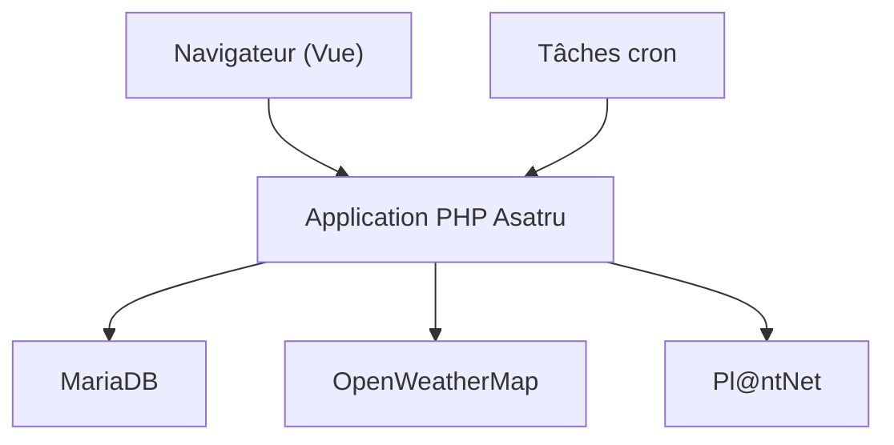

# danielbrendel/hortusfox-web

> Application web auto-hébergée de gestion collaborative de plantes, pour jardiniers et collectifs.

## Le problème
Suivre l'arrosage, les photos et les tâches de nombreuses plantes dans plusieurs lieux se disperse vite entre notes et calendriers.

## Ce que ça fait vraiment
Chaque plante est rattachée à un lieu. L'appli gère fiches, tâches, inventaire, calendrier, historique, météo, messagerie de groupe, QR codes et sauvegardes, avec thèmes et API REST. Elle repose sur PHP, MariaDB, Vue et un framework maison, Asatru.

## Comment c'est branché
Schéma simplifié d'après la fiche, sans diagramme fourni.



## Essayer
```bash
git clone https://github.com/danielbrendel/hortusfox-web.git
cd hortusfox-web
docker compose pull
docker compose up -d
# puis http://localhost:8080
```

## Coût et pièges
Gratuit, MIT. Mots de passe par défaut à changer dans `docker-compose.yml`. Météo et identification des plantes demandent un compte et une clé d'API chez des tiers. SMTP requis pour les e-mails.

## Ce que ce n'est pas
Pas un outil professionnel d'agronomie : c'est un carnet de plantes. Les tests d'application sont annoncés comme en construction.

## Alternatives
- Aucune alternative nommée dans le README.

## Pour toi
À ignorer côté travail : un projet perso sympathique, mais sans lien avec data, IA ou MLOps.

