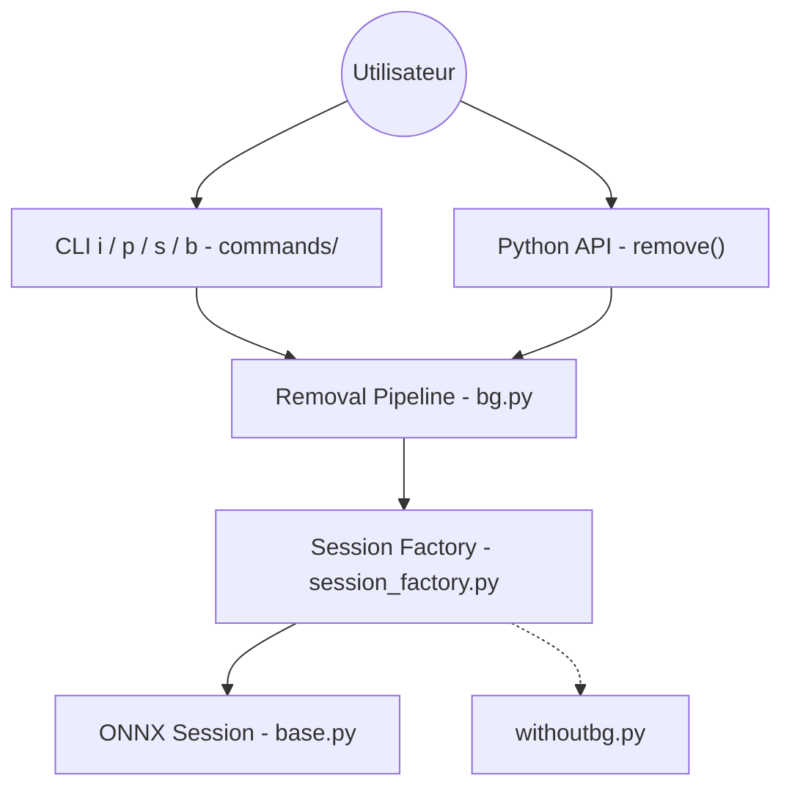

# danielgatis/rembg

> Python tool and CLI that removes image backgrounds, as a library, a command line or an HTTP server.

## The problem
Cutting out images by hand or through an online service costs time or sends your images to a third party.

## What it actually does
Loads a local ONNX model (bria-rmbg by default, also u2net, birefnet, sam, isnet) and produces a cutout or a mask. Subcommands `i` (file), `p` (folder, watch mode), `s` (HTTP server), `b` (RGB24 stream for FFmpeg), `d` and `m` (models). Edge options: `-dc` (decontamination), `-a` (alpha matting), `-vm` (ViTMatte). Two optional cloud backends: withoutBG and Atlas Cloud.

## How it is wired


## Trying it
```bash
rembg i path/to/input.png path/to/output.png
rembg i -dc path/to/input.png path/to/output.png
rembg p path/to/input path/to/output
rembg s --host 0.0.0.0 --port 7000 --log_level info
```
The installation commands (choice of CPU or GPU backend) are not in the README excerpt.

## Cost and gotchas
Python 3.11 to 3.13. Models are downloaded on first use (bria-rmbg about 1 GB). Cloud backends are billed per API key; on the server, they stay disabled by default (`--allow-remote-models`).

## What it is not
Not an image editor. The repository is MIT, but the default model RMBG-2.0 requires a paid agreement for commercial use: check the license of each model.

## Alternatives
No alternative named in the README (withoutBG and Atlas Cloud are built-in backends).

## For you
Adopt for image preprocessing or dataset preparation, provided you check the license of the chosen model.
