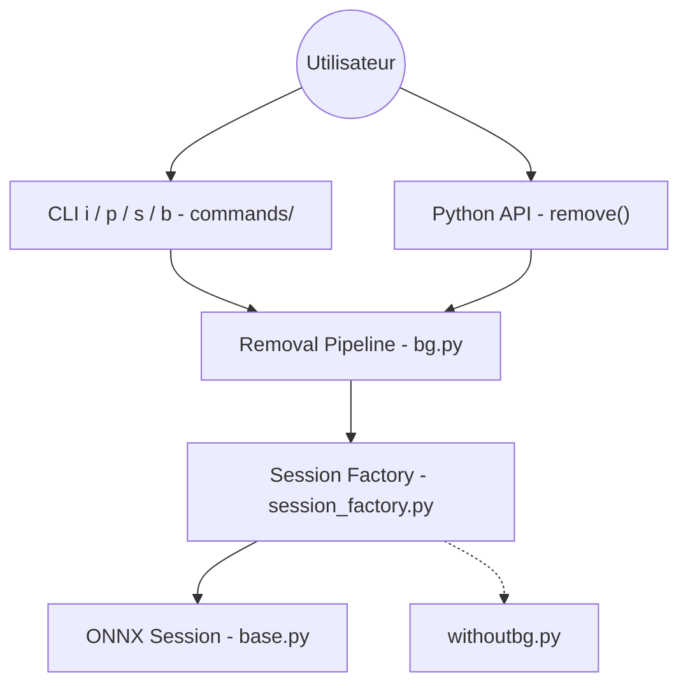

# danielgatis/rembg

> Outil Python et CLI qui retire l'arrière-plan d'images, en bibliothèque, en ligne de commande ou en serveur HTTP.

## Le problème
Détourer des images à la main ou via un service en ligne coûte du temps ou envoie tes images chez un tiers.

## Ce que ça fait vraiment
Charge un modèle ONNX local (bria-rmbg par défaut, aussi u2net, birefnet, sam, isnet) et produit un détourage ou un masque. Sous-commandes `i` (fichier), `p` (dossier, mode watch), `s` (serveur HTTP), `b` (flux RGB24 pour FFmpeg), `d` et `m` (modèles). Options de bords : `-dc` (décontamination), `-a` (alpha matting), `-vm` (ViTMatte). Deux backends cloud optionnels : withoutBG et Atlas Cloud.

## Comment c'est branché


## Essayer
```bash
rembg i path/to/input.png path/to/output.png
rembg i -dc path/to/input.png path/to/output.png
rembg p path/to/input path/to/output
rembg s --host 0.0.0.0 --port 7000 --log_level info
```
Les commandes d'installation (choix du backend CPU ou GPU) ne figurent pas dans l'extrait du README.

## Coût et pièges
Python 3.11 à 3.13. Les modèles se téléchargent au premier usage (bria-rmbg environ 1 Go). Les backends cloud sont facturés à la clé d'API ; sur le serveur, ils restent désactivés par défaut (`--allow-remote-models`).

## Ce que ce n'est pas
Pas un éditeur d'images. Le dépôt est MIT, mais le modèle par défaut RMBG-2.0 exige un accord payant pour un usage commercial : vérifier la licence de chaque modèle.

## Alternatives
Aucune alternative nommée dans le README (withoutBG et Atlas Cloud sont des backends intégrés).

## Pour toi
À adopter pour du prétraitement d'images ou de la préparation de datasets, à condition de contrôler la licence du modèle choisi.

