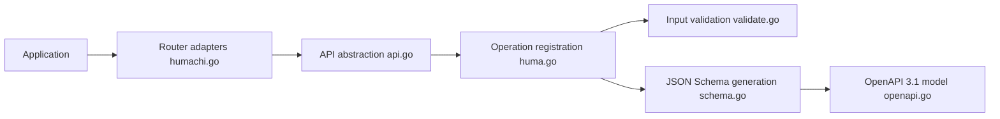

# danielgtaylor/huma

> Go micro-framework for REST/RPC APIs described with OpenAPI 3.1 and JSON Schema, inspired by FastAPI.

## The problem
Keeping API documentation in sync with Go code without writing the schemas by hand.

## What it actually does
You declare typed operations; Huma binds parameters and body, validates, calls the handler, serializes (JSON, optional CBOR) and returns RFC 9457 errors. It generates OpenAPI and JSON schemas by reflection, and plugs into your router (Chi, standard mux, Gin, Echo, Fiber...) through adapters. Automatic PATCH, SSE and a built-in CLI are available.

## How it is wired


## Trying it
```bash
go get -u github.com/danielgtaylor/huma/v2
go run greet.go
restish :8888/greeting/world
```

## Cost and gotchas
Free. Go 1.25 or later required. 132 open issues, a single main maintainer.

## What it is not
It is not a server: you keep your own. The README's testimonials are user opinions, not measurements.

## Alternatives
- FastAPI: the inspiration, in Python.

## For you
Worth watching: keep in mind if you serve models in Go with an OpenAPI specification; in Python, FastAPI remains more direct.
