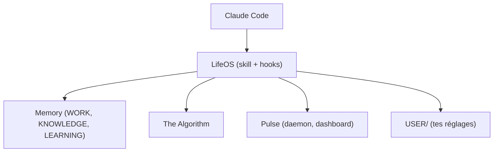

# danielmiessler/LifeOS

> Memory, skills and personal context layer on top of Claude Code for a lasting AI assistant.

## The problem
A coding agent forgets your goals and preferences from one session to the next and you have to re-explain everything.

## What it actually does
Installed by an agent, it adds to your harness a persistent memory, 97 public skills, a personal context (goals, contacts), automatic routing and self-improvement mechanisms. It also offers a dashboard (Pulse) and a work loop called the Algorithm. The code is in TypeScript and Bash.

## How it is wired

Diagram drawn from the README, no diagram supplied.

## Trying it
```bash
curl -fsSL https://ourlifeos.ai/install.sh | bash
# ou, dans ton agent :
# Read https://ourlifeos.ai/install and install LifeOS for me.
cp -r ~/.claude ~/.claude-backup-$(date +%Y%m%d)
```

## Cost and gotchas
It runs on Claude Code, with a subscription or keys at your expense, and bun. The author says security is not guaranteed: the installer asks you to accept that. It modifies your `~/.claude`: back up first.

## What it is not
Not a stable product: it is one person's personal system, published as is and constantly evolving. Not an autonomous agent on its own.

## Alternatives
- Fabric: a collection of prompts, complementary and not competing according to the README.

## For you
Watch: a good source of ideas (memory, hooks, skills) for your own Claude Code setup, but too personal and unstable to install as is.
