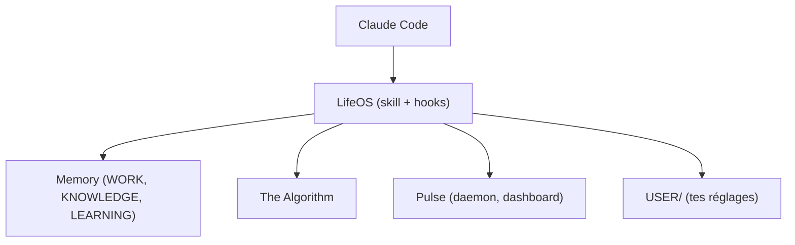

# danielmiessler/LifeOS

> Couche de mémoire, de skills et de contexte personnel posée sur Claude Code pour un assistant IA durable.

## Le problème
Un agent de code oublie tes objectifs et tes préférences d'une session à l'autre et tu dois tout réexpliquer.

## Ce que ça fait vraiment
Installé par un agent, il ajoute à ton harnais une mémoire persistante, 97 skills publics, un contexte personnel (objectifs, contacts), un routage automatique et des mécanismes d'auto-amélioration. Il propose aussi un tableau de bord (Pulse) et une boucle de travail nommée l'Algorithm. Le code est en TypeScript et Bash.

## Comment c'est branché

Schéma tiré du README, aucun diagramme fourni.

## Essayer
```bash
curl -fsSL https://ourlifeos.ai/install.sh | bash
# ou, dans ton agent :
# Read https://ourlifeos.ai/install and install LifeOS for me.
cp -r ~/.claude ~/.claude-backup-$(date +%Y%m%d)
```

## Coût et pièges
Il tourne sur Claude Code, avec abonnement ou clés à ta charge, et bun. L'auteur dit que la sécurité n'est pas garantie : l'installeur demande de l'accepter. Il modifie ton `~/.claude` : sauvegarde d'abord.

## Ce que ce n'est pas
Pas un produit stable : c'est le système personnel d'une seule personne, publié tel quel et en évolution constante. Pas un agent autonome à lui seul.

## Alternatives
- Fabric : collection de prompts, complémentaire et non concurrente selon le README.

## Pour toi
À surveiller : bonne source d'idées (mémoire, hooks, skills) pour ton propre setup Claude Code, mais trop personnel et instable pour l'installer tel quel.

