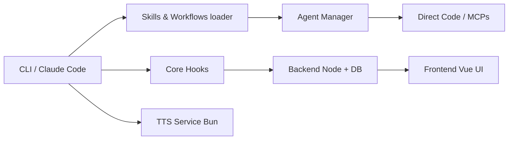

# danielmiessler/Personal_AI_Infrastructure

> LifeOS (formerly PAI): a layer of skills, memory and personal context on top of Claude Code.

## The problem
A coding agent starts from zero every session: it knows neither your goals, nor your preferences, nor what it has learned.

## What it actually does
A single skill that installs 49 skills, hooks, agents, a "Pulse" daemon (dashboard, voice, cron), a structured memory (WORK, KNOWLEDGE, LEARNING…) and a goals file (TELOS). A seven-phase "Algorithm" loop, from the current state to the ideal state. Mostly tested on Claude Code.

## How it is wired
The supplied diagram dates from the PAI v2 era (`.claude/` folder): it does not reflect the current README.


## Trying it
```bash
# Dans ton agent : "Read https://ourlifeos.ai/install and install LifeOS for me."
curl -fsSL https://ourlifeos.ai/install.sh | bash
```

## Cost and gotchas
Requires an agent harness (Claude Code) and bun; LLM calls are billed to you. The installation modifies `~/.claude`: the README advises a prior backup.

## What it is not
Not a prompt framework (that is fabric's role, according to the author). Not ready to use: an interview is needed to populate your personal data.

## Alternatives
- fabric: a collection of prompts per task, complementary.

## For you
Watch: a good source of ideas (memory, hooks, verification) to borrow, but installing it in full rewrites your Claude Code config and mixes personal life and work.
