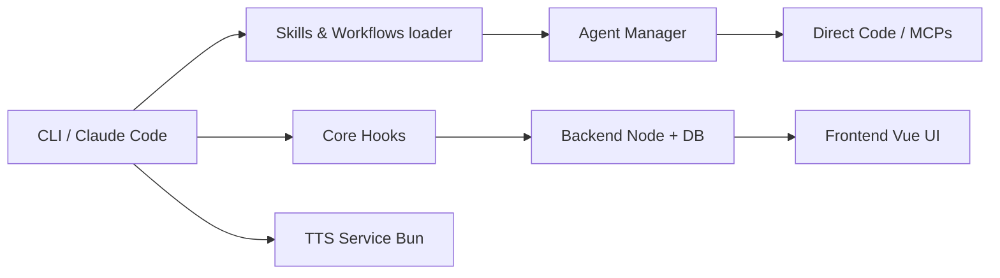

# danielmiessler/Personal_AI_Infrastructure

> LifeOS (ex-PAI) : une couche de skills, mémoire et contexte personnel posée sur Claude Code.

## Le problème
Un agent de code repart de zéro à chaque session : il ne connaît ni tes objectifs, ni tes préférences, ni ce qu'il a appris.

## Ce que ça fait vraiment
Un skill unique qui installe 49 skills, hooks, agents, un démon « Pulse » (dashboard, voix, cron), une mémoire structurée (WORK, KNOWLEDGE, LEARNING…) et un fichier d'objectifs (TELOS). Boucle « Algorithm » en sept phases, de l'état actuel à l'état idéal. Testé surtout sur Claude Code.

## Comment c'est branché
Le schéma fourni date de l'ère PAI v2 (dossier `.claude/`) : il ne reflète pas le README actuel.


## Essayer
```bash
# Dans ton agent : "Read https://ourlifeos.ai/install and install LifeOS for me."
curl -fsSL https://ourlifeos.ai/install.sh | bash
```

## Coût et pièges
Exige un harnais d'agent (Claude Code) et bun ; appels LLM facturés chez toi. L'installation modifie `~/.claude` : le README conseille une sauvegarde préalable.

## Ce que ce n'est pas
Pas un framework de prompts (c'est le rôle de fabric, selon l'auteur). Pas prêt à l'emploi : il faut une interview pour peupler tes données personnelles.

## Alternatives
- fabric : collection de prompts par tâche, complémentaire.

## Pour toi
Surveiller : bonne source d'idées (mémoire, hooks, vérification) à piquer, mais l'installer en entier réécrit ta config Claude Code et mêle vie perso et travail.

