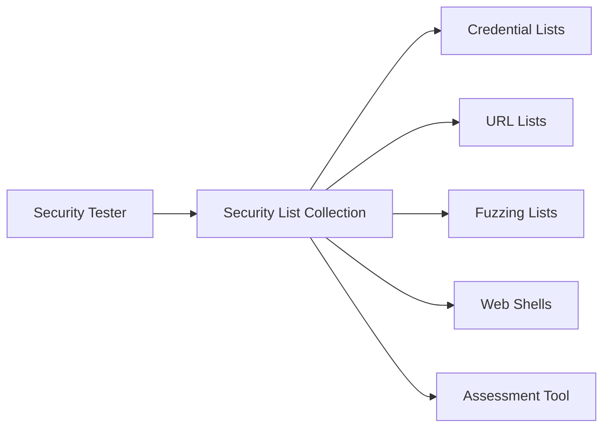

# danielmiessler/SecLists

> Collection of lists (passwords, URLs, fuzzing payloads) for security testers.

## The problem
A penetration test requires gathering scattered lists of usernames, passwords, sensitive patterns and attack payloads.

## What it actually does
Repository of lists organized by type: credentials, URLs, sensitive-data patterns, fuzzing payloads, web shells. You clone it onto the test machine and feed an assessment tool. The `.bin` folder contains list generators and mutators.

## How it is wired


## Trying it
```
git clone --depth 1 https://github.com/danielmiessler/SecLists.git
apt -y install seclists
```

## Cost and gotchas
Free (MIT). The repository triggers antivirus false positives; the README advises against storing it on a server or an important system (risk of local file inclusion).

## What it is not
It is not a tool: no attack program, only data. To be used only on authorized targets.

## Alternatives
Assetnote Wordlists, FuzzDB, PayloadsAllTheThings, SamLists (cited as similar projects).

## For you
Ignore: useful for offensive security, but outside the data / AI / MLOps scope, except for an occasional security audit.
