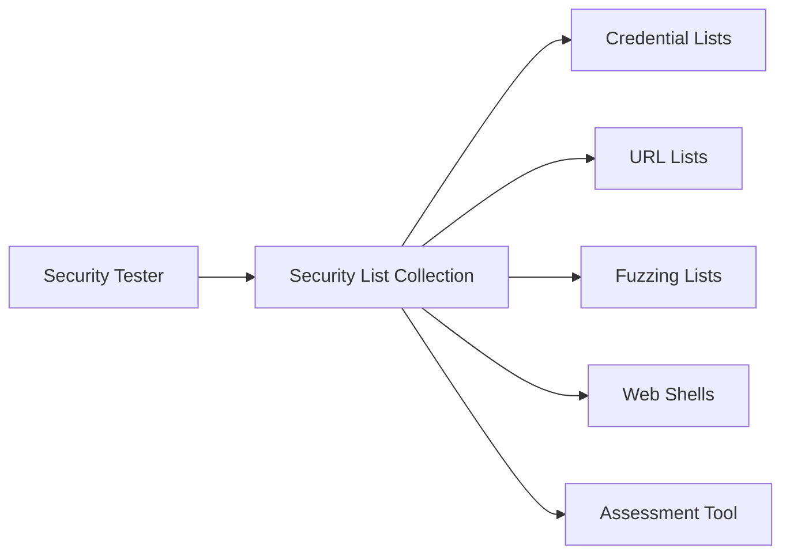

# danielmiessler/SecLists

> Collection de listes (mots de passe, URL, charges de fuzzing) pour testeurs en sécurité.

## Le problème
Un test d'intrusion demande de réunir des listes éparses de noms d'utilisateur, mots de passe, motifs sensibles et charges d'attaque.

## Ce que ça fait vraiment
Dépôt de listes organisées par type : identifiants, URL, motifs de données sensibles, charges de fuzzing, web shells. On le clone sur la machine de test et on alimente un outil d'évaluation. Le dossier `.bin` contient des générateurs et mutateurs de listes.

## Comment c'est branché


## Essayer
```
git clone --depth 1 https://github.com/danielmiessler/SecLists.git
apt -y install seclists
```

## Coût et pièges
Gratuit (MIT). Le dépôt déclenche des faux positifs d'antivirus ; le README déconseille de le stocker sur un serveur ou un système important (risque d'inclusion de fichier local).

## Ce que ce n'est pas
Ce n'est pas un outil : aucun programme d'attaque, seulement des données. À n'utiliser que sur des cibles autorisées.

## Alternatives
Assetnote Wordlists, FuzzDB, PayloadsAllTheThings, SamLists (cités comme projets similaires).

## Pour toi
À ignorer : utile pour la sécurité offensive, mais hors du périmètre data / IA / MLOps, sauf audit de sécurité ponctuel.

