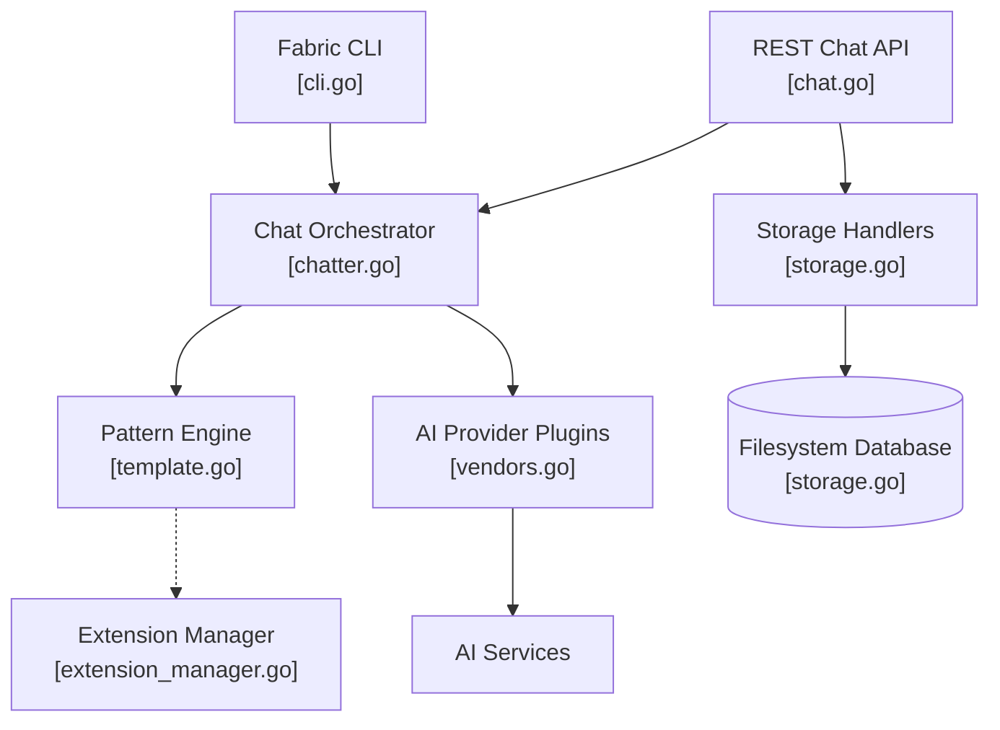

# danielmiessler/fabric

> Command-line tool that organizes reusable prompts, called Patterns.

## The problem
Useful prompts are scattered across notes, tabs and chat histories: impossible to
know which ones are good, or to version them.

## What it actually does
Stores prompts as Patterns callable with `fabric --pattern <name>`, with variables, contexts
and sessions persisted in a filesystem database.
Pulls input from a file, the clipboard, a URL scraped via Jina AI, a YouTube video
(transcript, comments, metadata, image OCR) or a Spotify podcast.
Talks to many providers (Anthropic, OpenAI, Gemini, Ollama, Azure, Bedrock…), with a model
assignable per Pattern. Exposes a REST API (`--serve`), an Ollama-compatible mode and a web UI.

## How it is wired


## Trying it
```bash
curl -fsSL https://raw.githubusercontent.com/danielmiessler/fabric/main/scripts/installer/install.sh | bash
go install github.com/danielmiessler/fabric/cmd/fabric@latest
fabric --setup
fabric -h
docker run --rm -it kayvan/fabric:latest --version
```

## Cost and gotchas
The tool is free, the models are not: each Pattern consumes your API key. Homebrew and AUR
install the command under the name `fabric-ai`, so an alias is needed. `--setup` is mandatory, even
after migrating from the old Python version. The `GOROOT`/`GOPATH` variables must be set by hand.

## What it is not
It is not a model or an autonomous agent: it sends a prompt and returns a response.
It is not a workflow manager: Patterns are chained through the shell, not through a graph.
The shipped Patterns are texts, their quality varies and nothing evaluates them.

## Alternatives
No alternative named in the README.

## For you
The right place to store your monitoring and summarization prompts so you can replay them without rewriting.
