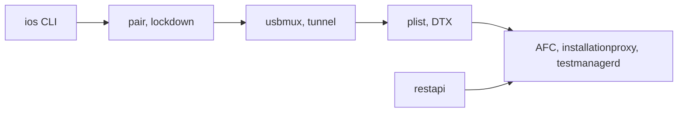

# danielpaulus/go-ios

> Cross-platform Go CLI to automate iOS devices from Linux, Windows or macOS.

## The problem
Driving an iPhone (install, launch, test, debug) without a Mac or Xcode.

## What it actually does
A single `ios` command with JSON output covers app installation, launching, XCTest and WebDriverAgent, screenshots, files, logs, profiles, location simulation, networking, developer images. Under the hood: discovery and pairing, usbmux/lockdown transport and a tunnel for iOS 17+, Apple codecs (plist, XPC, DTX, NSKeyedArchiver), then one client per service. An experimental REST API exists.

## How it is wired


## Trying it
```bash
npm install -g go-ios
ios --help
sudo ios tunnel start
ios list
ios install --path=/path/to/app
```

## Cost and gotchas
Free. iOS 17+ requires a tunnel daemon started as administrator; on Windows, `wintun.dll` must be copied.

## What it is not
Not a complete testing tool: it runs XCTests but does not write them. The REST API remains experimental.

## Alternatives
No alternative named in the README.

## For you
Ignore unless you automate iOS mobile tests; little connection to data or MLOps.
