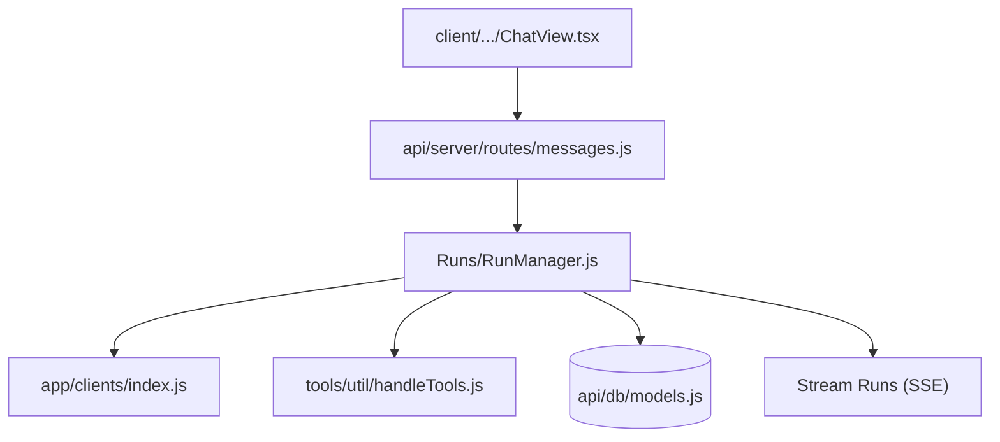

# danny-avila/LibreChat

> AI-powered chat interface for self-hosting, unifying providers, agents, MCPs, files, and artifacts.

## The problem
Each model provider has its own interface, accounts, and billing system: there is no single, private entry point.

## What it actually does
ChatGPT-inspired interface with provider choice (Anthropic, OpenAI, Azure, Google, Bedrock, Ollama, and other compatible OpenAI endpoints), no-code agents, `SKILL.md` skills, MCP (Multi-Cloud Platform), code interpreter, web search, artifacts, image generation, conversation import and export, multi-user authentication (OAuth2, LDAP). Version 0.8.8 adds an agent management API (beta) and attached workspaces (very experimental).

## How it is wired

## Trying it
There are no installation instructions in the README provided: it directs users to librechat.ai/docs. The repository contains Docker Compose stacks, including the admin panel.

## Cost and gotchas
Charges for using the models are billed by each provider. A database is required, and options include Redis, S3, or ClickHouse (code interpreter). The associated workspaces are "highly experimental."

## What it is not
This is not a template or proxy that saves on API usage. It is not minimal: there are many functions to configure.

## Alternatives
No alternative is specified in the README.

## For you
Excellent self-hosted gateway to multiple LLMs and MCP servers, with Langfuse and OpenTelemetry tracing: use it for team use.
