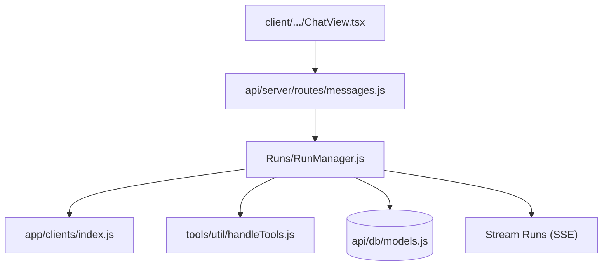

# danny-avila/LibreChat

> Interface de chat IA à auto-héberger qui unifie fournisseurs, agents, MCP, fichiers et artefacts.

## Le problème
Chaque fournisseur de modèles a son interface, ses comptes et sa facturation : pas de point d'entrée unique et privé.

## Ce que ça fait vraiment
Interface inspirée de ChatGPT avec choix de fournisseur (Anthropic, OpenAI, Azure, Google, Bedrock, Ollama et autres endpoints compatibles OpenAI), agents sans code, skills `SKILL.md`, MCP, interpréteur de code, recherche web, artefacts, génération d'images, import et export de conversations, authentification multi-utilisateurs (OAuth2, LDAP). La v0.8.8 ajoute une API de gestion d'agents (bêta) et des espaces de travail attachés (très expérimentaux).

## Comment c'est branché

## Essayer
Aucune commande d'installation dans le README fourni : il renvoie vers librechat.ai/docs. Le dépôt contient des stacks Docker Compose, y compris l'admin panel.

## Coût et pièges
Les appels aux modèles sont facturés par chaque fournisseur. Il faut une base de données et, selon les options, Redis, S3 ou ClickHouse (interpréteur de code). Les espaces de travail attachés sont « très expérimentaux ».

## Ce que ce n'est pas
Pas un modèle ni un proxy qui économise sur l'API. Pas minimal : beaucoup de fonctions à configurer.

## Alternatives
Aucune alternative nommée dans le README.

## Pour toi
Excellente passerelle auto-hébergée vers plusieurs LLM et serveurs MCP, avec traçage Langfuse et OpenTelemetry : adopte-la pour un usage équipe.

