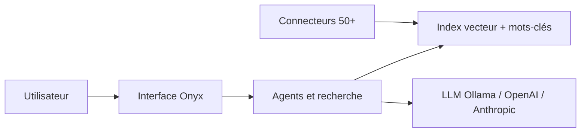

# danswer-ai/danswer

> Open source AI platform (now Onyx): chat, RAG over your sources and agents, self-hostable.

## The problem
Connecting LLMs to an organization's documents (Slack, Drive, wikis…) without building the interface, indexing and access rights yourself.

## What it actually does
Chat interface with agentic RAG over a hybrid index, 50+ connectors or MCP, web search, deep research, custom agents, sandboxed code execution, image generation, voice mode. Two modes: Lite (under 1 GB, simple chat interface) and Standard (vector and keyword index, workers, inference servers, Redis, MinIO). All major LLM providers are supported, including Ollama and vLLM.

## How it is wired


## Trying it
```bash
curl -fsSL https://onyx.app/install_onyx.sh | bash
```

## Cost and gotchas
Community edition under the MIT license according to the README, but the catalog flags an unidentified license: to be checked. Separate Enterprise edition (SSO, RBAC, analytics). Remote LLMs cost tokens; Standard mode is resource-hungry.

## What it is not
Not a simple library: it is a complete application to deploy. The "top of the ranking" results and the announced benchmark cannot be verified from the README.

## Alternatives
No alternative cited in the README.

## For you
Worth adopting to set up an internal RAG with an assistant deployable in one script, after first checking the community edition's license.
