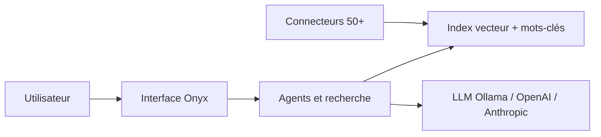

# danswer-ai/danswer

> Plateforme IA open source (devenue Onyx) : chat, RAG sur tes sources et agents, auto-hébergeable.

## Le problème
Brancher des LLM sur les documents d'une organisation (Slack, Drive, wikis…) sans bâtir soi-même l'interface, l'indexation et les droits d'accès.

## Ce que ça fait vraiment
Interface de chat avec RAG agentique sur index hybride, plus de 50 connecteurs ou MCP, recherche web, recherche approfondie, agents personnalisés, exécution de code en bac à sable, génération d'images, mode vocal. Deux modes : Lite (moins de 1 Go, simple interface de chat) et Standard (index vecteur et mots-clés, workers, serveurs d'inférence, Redis, MinIO). Tous les grands fournisseurs de LLM sont pris en charge, y compris Ollama et vLLM.

## Comment c'est branché


## Essayer
```bash
curl -fsSL https://onyx.app/install_onyx.sh | bash
```

## Coût et pièges
Édition communautaire sous licence MIT selon le README, mais le catalogue signale une licence non identifiée : à vérifier. Édition Enterprise séparée (SSO, RBAC, analytics). Les LLM distants coûtent des tokens ; le mode Standard est gourmand en ressources.

## Ce que ce n'est pas
Pas une simple bibliothèque : c'est une application complète à déployer. Les résultats « top du classement » et le benchmark annoncé ne sont pas vérifiables depuis le README.

## Alternatives
Aucune alternative citée dans le README.

## Pour toi
À adopter pour monter un RAG interne avec un assistant déployable en un script, en vérifiant d'abord la licence de l'édition communautaire.

