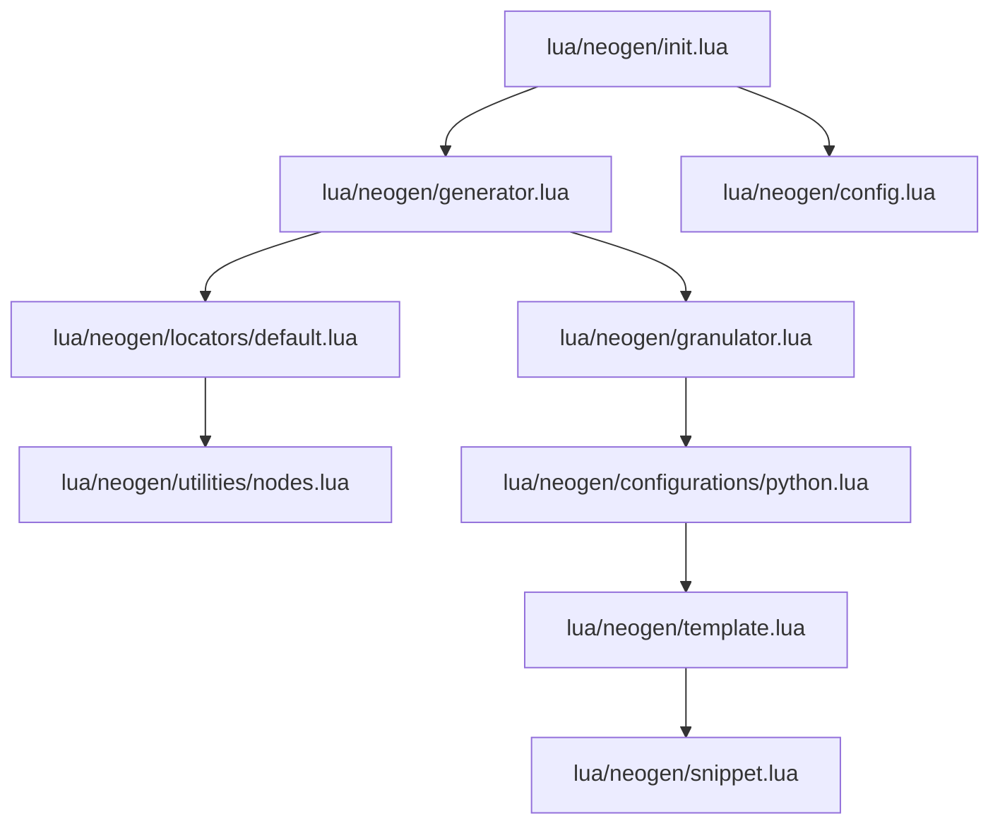

# danymat/neogen

> Neovim plugin that generates the documentation comments of a function or class with a single shortcut.

## The problem
Writing docstrings (parameters, returns) by hand is repetitive and quickly becomes inconsistent with the language's convention.

## What it actually does
The `:Neogen` command finds the current Tree-sitter node (function, class, type, file) then injects a language-specific annotation template, converted into a snippet. The cursor jumps from field to field. Conventions (e.g. google_docstrings, emmylua) are configurable per language.

## How it is wired


## Trying it
```bash
make test
```
```lua
require('neogen').generate()
```
Installation: `{ "danymat/neogen", config = true }` with lazy.nvim.

## Cost and gotchas
Free. The Tree-sitter parsers for the target language must be installed. GPL-3.0 license: copyleft, worth knowing if you embed the code.

## What it is not
Does not write the content of the doc: it creates the comment skeleton, it does not describe what your function does.

## Alternatives
No alternative named in the README.

## For you
Watch: handy for consistent Python docstrings if you work in Neovim, of no interest otherwise.
