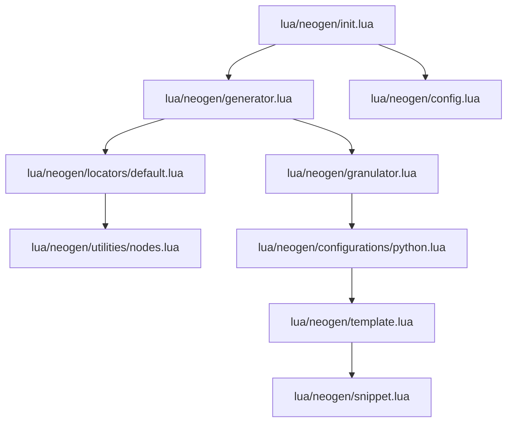

# danymat/neogen

> Plugin Neovim qui génère les commentaires de documentation d'une fonction ou d'une classe d'un seul raccourci.

## Le problème
Écrire à la main les docstrings (paramètres, retours) est répétitif et vite incohérent avec la convention du langage.

## Ce que ça fait vraiment
La commande `:Neogen` repère le nœud Tree-sitter courant (fonction, classe, type, fichier) puis injecte un modèle d'annotation propre au langage, converti en snippet. Le curseur saute de champ en champ. Les conventions (ex. google_docstrings, emmylua) sont configurables par langage.

## Comment c'est branché


## Essayer
```bash
make test
```
```lua
require('neogen').generate()
```
Installation : `{ "danymat/neogen", config = true }` avec lazy.nvim.

## Coût et pièges
Gratuit. Il faut avoir installé les parseurs Tree-sitter du langage visé. Licence GPL-3.0 : copyleft, à connaître si tu embarques le code.

## Ce que ce n'est pas
Ne rédige pas le contenu de la doc : il crée le squelette du commentaire, il ne décrit pas ce que fait ta fonction.

## Alternatives
Aucune alternative nommée dans le README.

## Pour toi
À surveiller : pratique pour des docstrings Python cohérentes si tu travailles sous Neovim, sans intérêt autrement.

