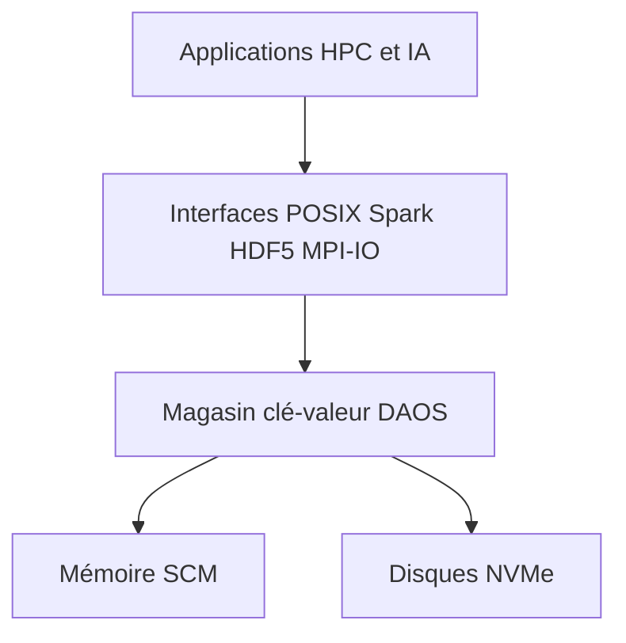

# daos-stack/daos

> Open source distributed object storage, designed for non-volatile memory, aimed at high-performance computing.

## The problem
Conventional file systems do not take advantage of persistent memory (SCM) or NVMe disks.

## What it actually does
Distributed key-value store with transactional non-blocking I/O, data protection with self-healing, end-to-end integrity and elastic storage. Announced interfaces: parallel file system, Hadoop/Spark connector, TensorFlow-IO, Python dictionaries, HDF5, MPI-IO. The rest is referred to the online documentation.

## How it is wired

Simplified diagram based on the sheet, no diagram provided.

## Trying it
```bash
# Aucune commande dans le README : voir la documentation en ligne.
```

## Cost and gotchas
Free, but the targeted hardware (SCM, NVMe, server cluster) is expensive. License present but not identified by GitHub: to be checked. 696 open tickets.

## What it is not
Not a ready-to-use cloud storage nor a tool for a workstation.

## Alternatives
No alternative named in the README.

## For you
Watch: the TensorFlow-IO and Spark connectors are relevant to large-scale training, but you need an HPC cluster to benefit from them.
