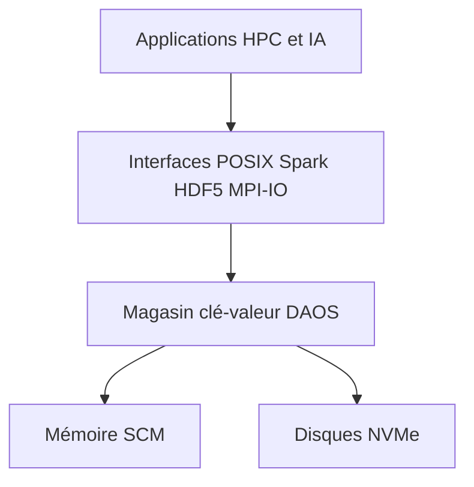

# daos-stack/daos

> Stockage objet distribué open source, conçu pour la mémoire non volatile, destiné au calcul haute performance.

## Le problème
Les systèmes de fichiers classiques ne tirent pas parti de la mémoire persistante (SCM) ni des disques NVMe.

## Ce que ça fait vraiment
Magasin clé-valeur distribué avec E/S transactionnelles non bloquantes, protection des données avec auto-réparation, intégrité de bout en bout et stockage élastique. Interfaces annoncées : système de fichiers parallèle, connecteur Hadoop/Spark, TensorFlow-IO, dictionnaires Python, HDF5, MPI-IO. Le reste est renvoyé à la documentation en ligne.

## Comment c'est branché

Schéma simplifié d'après la fiche, sans diagramme fourni.

## Essayer
```bash
# Aucune commande dans le README : voir la documentation en ligne.
```

## Coût et pièges
Gratuit, mais le matériel visé (SCM, NVMe, grappe de serveurs) est coûteux. Licence présente mais non identifiée par GitHub : à vérifier. 696 tickets ouverts.

## Ce que ce n'est pas
Pas un stockage cloud prêt à l'emploi ni un outil pour un poste de travail.

## Alternatives
Aucune alternative nommée dans le README.

## Pour toi
Surveiller : les connecteurs TensorFlow-IO et Spark concernent l'entraînement à grande échelle, mais il faut une grappe HPC pour en profiter.

