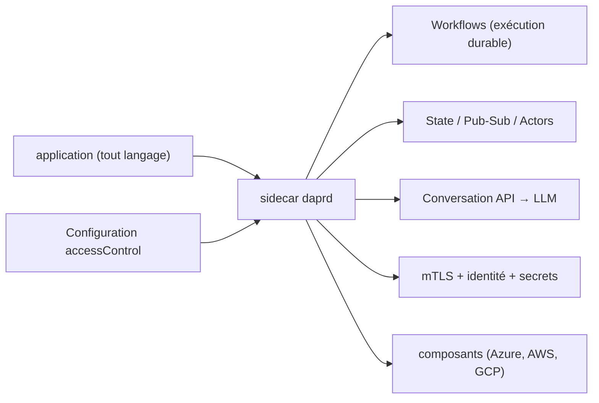

# dapr/dapr

> Sidecar runtime that provides durable execution, state, messaging and security to any application.

## The problem
A long-running job that crashes starts over from scratch: nothing persists its progress unless you write your own state machine.
Each language and each cloud imposes different plumbing for state, messaging and secrets.

## What it actually does
Runs as a sidecar: all capabilities are accessible over HTTP and gRPC from any language.
Workflows automatically persist progress and resume at the next step after a crash, pod restart or node failure.
Building blocks à la carte: service invocation (mTLS, retries), state, pub/sub, actors, Conversation (LLM with prompt caching and tool calls), secrets, locks, cryptography, jobs.
Per-application cryptographic identity, mTLS everywhere, access policies in YAML, and verifiable execution (origin, lineage, history integrity).

## How it is wired

## Trying it
No installation command is written in the README: it points to the "Getting Started" guide in the documentation and to the quickstarts repository. Only an example YAML access policy is provided.

## Cost and gotchas
Free; binary of about 58 MB using ~4 MB of memory, adoptable API by API.
Components (state stores, brokers) remain third-party services to provision and pay for.

## What it is not
It is not an application framework: no dependency in your code, adoption happens through HTTP/gRPC calls.
It is not an agent framework: it provides execution primitives and works alongside your AI framework.
It is not limited to Kubernetes: virtual machines, edge and air-gapped deployments are covered.

## Alternatives
No alternative named in the README.

## For you
Worth knowing if your agents must survive restarts in production; overkill for a prototype.
