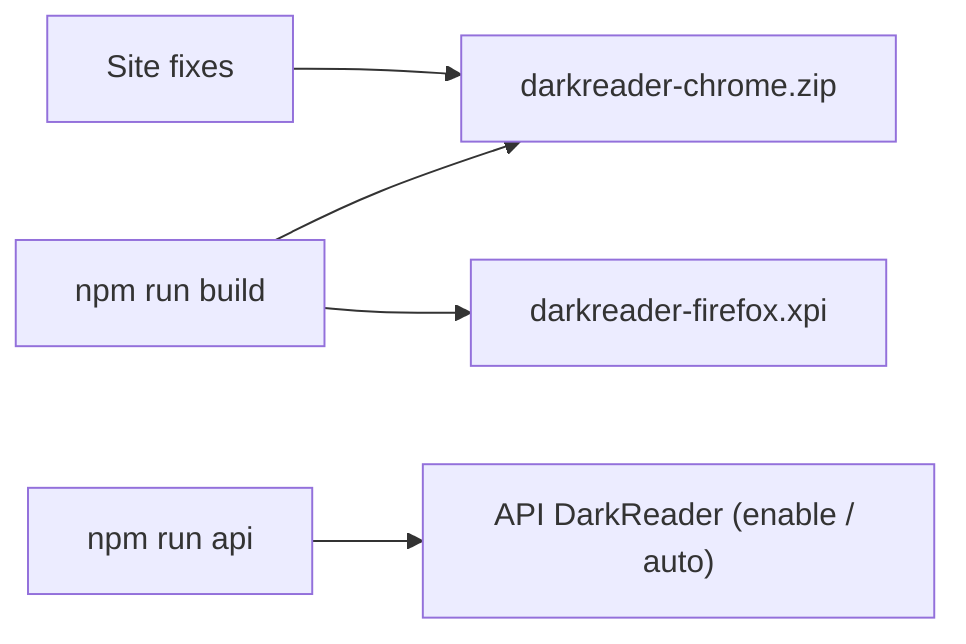

# darkreader/darkreader

> Browser extension and JavaScript library that applies a dark mode to any website.

## The problem
Many sites have no dark theme, which strains the eyes at night.

## What it actually does
Generates CSS to darken pages, with brightness, contrast and sepia settings. Installs as a Chrome or Firefox extension, or integrates into a site via the `darkreader` npm package (`enable`, `disable`, `auto`, `exportGeneratedCSS`). Per-site fixes ship with each release.

## How it is wired

Simplified diagram based on the fiche, no diagram provided.

## Trying it
```bash
npm install
npm run build
npm install darkreader
```
```javascript
DarkReader.enable({ brightness: 100, contrast: 90, sepia: 10 });
DarkReader.disable();
```

## Cost and gotchas
Free, MIT license. Build: Node.js 15 or later (Deno experimental). Site-fix synchronization is disabled by default. Allowing the extension on Firefox's restricted pages creates a security risk and affects all extensions. More than 1,400 open issues.

## What it is not
Not a native theme of the sites: it rewrites the style on the fly, with possible failures on some sites. Adds the `chrome` object to `window` when used as a library.

## Alternatives
No alternative named in the README.

## For you
Adopt: a daily comfort useful for long sessions in front of dashboards or documentation, unrelated to data analysis itself.
