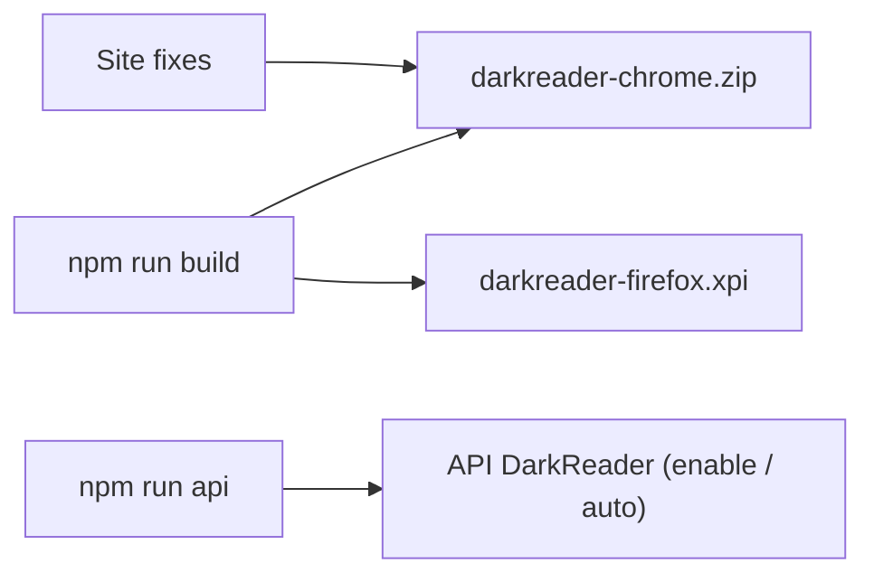

# darkreader/darkreader

> Extension de navigateur et bibliothèque JavaScript qui applique un mode sombre à n'importe quel site.

## Le problème
Beaucoup de sites n'ont pas de thème sombre, ce qui fatigue la vue la nuit.

## Ce que ça fait vraiment
Génère du CSS pour assombrir les pages, avec réglages de luminosité, contraste et sépia. S'installe comme extension Chrome ou Firefox, ou s'intègre à un site via le paquet npm `darkreader` (`enable`, `disable`, `auto`, `exportGeneratedCSS`). Les correctifs par site sont livrés avec chaque version.

## Comment c'est branché

Schéma simplifié d'après la fiche, sans diagramme fourni.

## Essayer
```bash
npm install
npm run build
npm install darkreader
```
```javascript
DarkReader.enable({ brightness: 100, contrast: 90, sepia: 10 });
DarkReader.disable();
```

## Coût et pièges
Gratuit, licence MIT. Construction : Node.js 15 ou plus (Deno expérimental). La synchronisation des correctifs de sites est désactivée par défaut. Autoriser l'extension sur les pages restreintes de Firefox expose à un risque de sécurité et touche toutes les extensions. Plus de 1 400 issues ouvertes.

## Ce que ce n'est pas
Pas un thème natif des sites : il réécrit le style à la volée, avec des échecs possibles sur certains sites. Ajoute l'objet `chrome` à `window` lorsqu'il est utilisé en bibliothèque.

## Alternatives
Aucune alternative nommée dans le README.

## Pour toi
À adopter : un confort quotidien utile aux longues sessions devant des tableaux de bord ou de la documentation, sans lien avec l'analyse de données elle-même.

