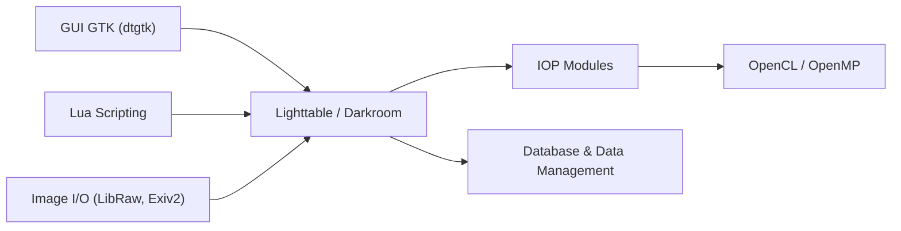

# darktable-org/darktable

> Free software for non-destructive RAW photo development, for photographers.

## The problem
Managing a library of digital negatives and editing them without altering the originals.

## What it actually does
GTK application with a lighttable and a darkroom. A database keeps the edit history, a pipeline of modules (iop) processes the images, Lua allows extensions. Optional AI features (masks, denoising, upscaling) require building with `-DUSE_AI=ON`; GPU acceleration goes through ONNX Runtime (CUDA, ROCm, OpenVINO, DirectML, CoreML).

## How it is wired


## Trying it
```bash
git clone --recurse-submodules https://github.com/darktable-org/darktable.git
cd darktable
./build.sh --prefix /opt/darktable --build-type Release --install --sudo
darktable --disable-opencl   # en cas de plantage au démarrage
```

## Cost and gotchas
Free. 8 GB of RAM and a GPU are recommended. One-way database upgrade: older versions can no longer read the edits. The master branch can corrupt the database and XMP files. Installation through a remote `curl | bash` script for the AI GPU support.

## What it is not
Not a free replacement for Lightroom, says the README. AI models are downloaded separately.

## Alternatives
No alternative named in the README.

## For you
Ignore: a photography application, outside your data/AI/MLOps field.
