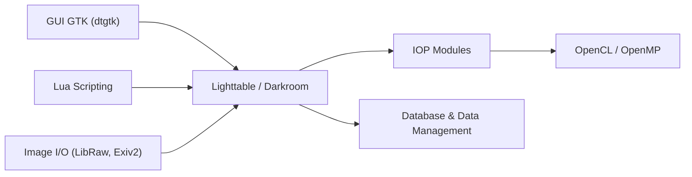

# darktable-org/darktable

> Logiciel libre de développement de photos RAW non destructif, pour photographes.

## Le problème
Gérer une bibliothèque de négatifs numériques et les retoucher sans altérer les originaux.

## Ce que ça fait vraiment
Application GTK avec table lumineuse et chambre noire. Une base de données garde l'historique d'édition, un pipeline de modules (iop) traite les images, Lua permet des extensions. Des fonctions IA optionnelles (masques, débruitage, agrandissement) demandent la compilation avec `-DUSE_AI=ON` ; l'accélération GPU passe par ONNX Runtime (CUDA, ROCm, OpenVINO, DirectML, CoreML).

## Comment c'est branché


## Essayer
```bash
git clone --recurse-submodules https://github.com/darktable-org/darktable.git
cd darktable
./build.sh --prefix /opt/darktable --build-type Release --install --sudo
darktable --disable-opencl   # en cas de plantage au démarrage
```

## Coût et pièges
Gratuit. 8 Go de RAM et un GPU sont recommandés. Mise à jour de la base à sens unique : les anciennes versions ne relisent plus les éditions. La branche master peut corrompre base et XMP. Installation par script distant `curl | bash` pour le GPU de l'IA.

## Ce que ce n'est pas
Pas un remplaçant gratuit de Lightroom, dit le README. Les modèles d'IA se téléchargent à part.

## Alternatives
Aucune alternative nommée dans le README.

## Pour toi
Ignorer : application de photographie, hors de ton métier data/IA/MLOps.

