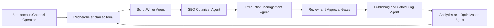

# darkzOGx/youtube-automation-agent

> Self-hosted agent that produces and publishes YouTube videos end to end, under human approval.

## The problem
Running a YouTube channel chains research, script, narration, visuals, editing, metadata and analysis.
Each step is a different tool, and nothing links the results to the following decisions.

## What it actually does
A chain of agents: strategy, script, thumbnail, SEO, production, publishing, analytics, with a feedback loop.
Nothing is scheduled until the quality, rights and human review gates are passed.
SQLite checkpoints per step: an interruption resumes at the first incomplete step.
Dedicated studios: scene repair, cutting into Shorts, evidence desk, controlled growth experiments.

## How it is wired


## Trying it
```bash
git clone https://github.com/darkzOGx/youtube-automation-agent.git
cd youtube-automation-agent
npm install
npm run walkthrough
npm start
```

## Cost and gotchas
Text, TTS and video provider keys at your expense; paid video generation is billed per second.
YouTube Data API credentials to create, and the paid verification probes are separate checkboxes.

## What it is not
Not neutral: the repository title carries a `pump` token address, which ties the project to a crypto operation.
Not autonomous for all that: human approval gates are everywhere, and this is presented as intended.
Not an editorial quality tool — it produces volume, relevance remains your responsibility.

## Alternatives
DarkzSEO, optional module by the same author for discoverability auditing.

## For you
Outside your scope, and the crypto tie is enough to rule it out; ignore.
