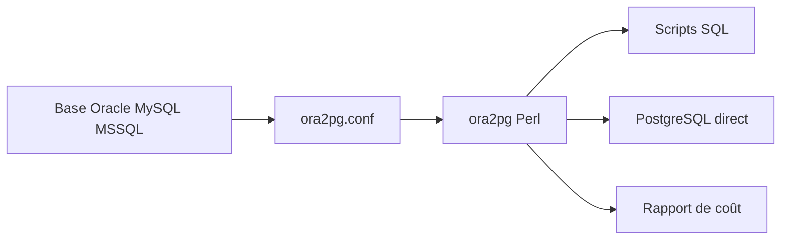

# darold/ora2pg

> Perl tool that converts an Oracle, MySQL or SQL Server schema and data to PostgreSQL.

## The problem
Migrating an Oracle database to PostgreSQL by hand is slow, especially with PL/SQL code.

## What it actually does
- Connects to the source database, extracts tables, views, sequences, indexes, triggers, functions, packages, partitions, types, privileges.
- Generates SQL scripts or loads directly into PostgreSQL (COPY or INSERT).
- Converts part of the PL/SQL to PL/pgSQL: manual review is mandatory.
- Estimates the migration cost (5-minute units, levels A to C), compares the two databases (TEST), validates the data.
- Is driven by `ora2pg.conf` and command-line options.

## How it is wired


## Trying it
```bash
ora2pg -t SHOW_VERSION -c config/ora2pg.conf
ora2pg -c config/ora2pg.conf -t TABLE -b outdir/
ora2pg -t SHOW_REPORT --estimate_cost
ora2pg --project_base /app/migration/ --init_project test_project
```

## Cost and gotchas
Free. Oracle Instant Client, DBD::Oracle and environment variables must be installed; access to the source database is required. On Windows, parallelism is disabled. GPL-3.0 licence.

## What it is not
Not a fully automatic migration: converted PL/SQL must be reviewed by hand. Change tracking after the first import is not handled (only SCN recording).

## Alternatives
Orafce (cited for not translating certain functions), oracle_fdw and Kettle (cited as loading options).

## For you
Keep an eye on it if you are migrating an Oracle warehouse to PostgreSQL: the cost report helps you decide before starting.
