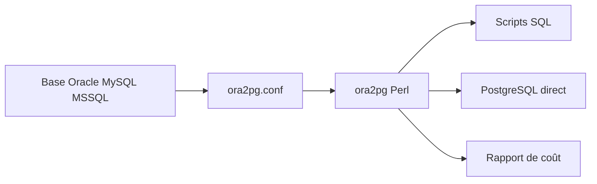

# darold/ora2pg

> Outil Perl qui convertit un schéma et des données Oracle, MySQL ou SQL Server vers PostgreSQL.

## Le problème
Migrer une base Oracle vers PostgreSQL à la main est long, surtout avec du code PL/SQL.

## Ce que ça fait vraiment
- Se connecte à la base source, extrait tables, vues, séquences, index, triggers, fonctions, paquets, partitions, types, droits.
- Génère des scripts SQL ou charge directement dans PostgreSQL (COPY ou INSERT).
- Convertit une partie du PL/SQL en PL/pgSQL : relecture manuelle obligatoire.
- Évalue le coût de migration (unités de 5 minutes, niveaux A à C), compare les deux bases (TEST), valide les données.
- Se pilote par `ora2pg.conf` et des options en ligne de commande.

## Comment c'est branché


## Essayer
```bash
ora2pg -t SHOW_VERSION -c config/ora2pg.conf
ora2pg -c config/ora2pg.conf -t TABLE -b outdir/
ora2pg -t SHOW_REPORT --estimate_cost
ora2pg --project_base /app/migration/ --init_project test_project
```

## Coût et pièges
Gratuit. Oracle Instant Client, DBD::Oracle et variables d'environnement à installer ; accès à la base source. Sur Windows, le parallélisme est désactivé. Licence GPL-3.0.

## Ce que ce n'est pas
Pas une migration automatique complète : le PL/SQL converti se relit à la main. Le suivi de changements après le premier import n'est pas géré (seulement l'enregistrement des SCN).

## Alternatives
Orafce (cité pour ne pas traduire certaines fonctions), oracle_fdw et Kettle (cités comme pistes de chargement).

## Pour toi
À surveiller si tu migres un entrepôt Oracle vers PostgreSQL : le rapport de coût aide à décider avant de commencer.

