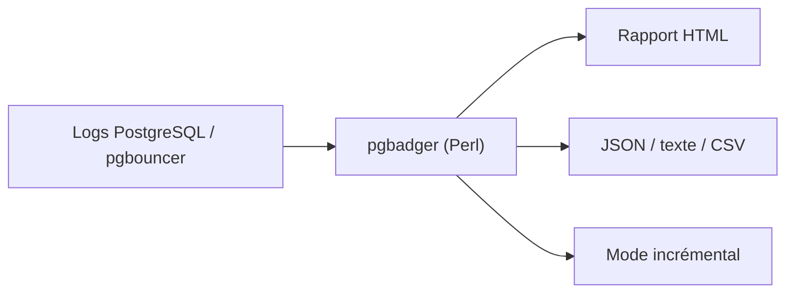

# darold/pgbadger

> Perl script that analyzes PostgreSQL logs and produces detailed HTML reports, for DBAs and operators.

## The problem
PostgreSQL logs are unreadable by hand: slow queries, errors and locks stay buried.

## What it actually does
Analyzes log files (syslog, stderr, csvlog, jsonlog, RDS, CloudSQL, pgbouncer), compressed or not, including remotely via ssh. Produces zoomable HTML reports: slowest or most frequent queries, errors, checkpoints, autovacuum, sessions. An incremental mode generates one report per day and per week.

## How it is wired
Simplified diagram based on the sheet, no diagram provided.



## Trying it
```bash
perl Makefile.PL
make && sudo make install
pgbadger /var/log/postgresql.log
pgbadger -j 8 /pglog/postgresql-10.1-main.log
pgbadger -I -q /var/log/postgresql/postgresql.log.1 -O /var/www/pg_reports/
```

## Cost and gotchas
Free. Logging must be enabled (`log_min_duration_statement = 0`), which can burden a busy server. Parallelism does not work on compressed files, on CSV, or under Windows.

## What it is not
It is not real-time monitoring: it reads logs after the fact. It does not replace a metrics tool.

## Alternatives
No alternative named in the README.

## For you
Adopt it if you run PostgreSQL (feature store, MLOps metadata database): a mature tool, with no dependencies, that quickly finds costly queries.
