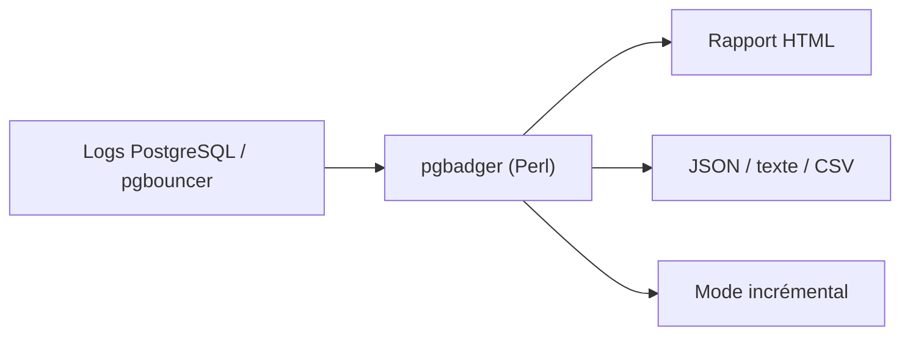

# darold/pgbadger

> Script Perl qui analyse les journaux PostgreSQL et produit des rapports HTML détaillés, pour DBA et exploitants.

## Le problème
Les journaux PostgreSQL sont illisibles à la main : requêtes lentes, erreurs et verrous restent noyés.

## Ce que ça fait vraiment
Analyse des fichiers de logs (syslog, stderr, csvlog, jsonlog, RDS, CloudSQL, pgbouncer), compressés ou non, y compris à distance via ssh. Produit des rapports HTML zoomables : requêtes les plus lentes ou fréquentes, erreurs, checkpoints, autovacuum, sessions. Un mode incrémental génère un rapport par jour et par semaine.

## Comment c'est branché
Schéma simplifié d'après la fiche, sans diagramme fourni.



## Essayer
```bash
perl Makefile.PL
make && sudo make install
pgbadger /var/log/postgresql.log
pgbadger -j 8 /pglog/postgresql-10.1-main.log
pgbadger -I -q /var/log/postgresql/postgresql.log.1 -O /var/www/pg_reports/
```

## Coût et pièges
Gratuit. Il faut activer la journalisation (`log_min_duration_statement = 0`), qui peut alourdir un serveur chargé. Le parallélisme ne marche ni sur fichiers compressés, ni en CSV, ni sous Windows.

## Ce que ce n'est pas
Ce n'est pas une supervision temps réel : il lit des journaux après coup. Il ne remplace pas un outil de métriques.

## Alternatives
Aucune alternative nommée dans le README.

## Pour toi
À adopter si tu exploites PostgreSQL (feature store, base de métadonnées MLOps) : outil mûr, sans dépendance, qui trouve vite les requêtes coûteuses.

