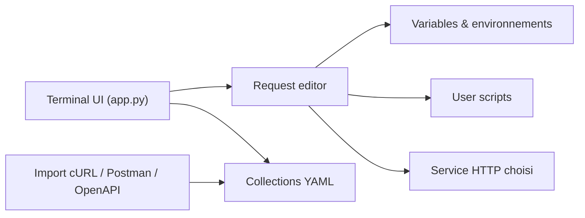

# darrenburns/posting

> Terminal HTTP client, Postman-style, for developers who love the keyboard and SSH.

## The problem
Graphical HTTP clients are heavy, hard to use over SSH, and store their requests in formats that are hard to version.

## What it actually does
A Textual TUI application that edits, runs and saves HTTP requests in local YAML files. Handles environments and variables, auto-completion, Python pre/post-request scripts, cURL, Postman and OpenAPI import, and cURL export.

## How it is wired


## Trying it
```bash
curl -LsSf https://astral.sh/uv/install.sh | sh
uv tool install --python 3.13 posting
posting
```

## Cost and gotchas
Free. Installed via uv (which installs Python 3.13 if needed). Homebrew and NixOS are not officially supported.

## What it is not
Not a load-testing tool nor a server; no backend is provided. User Python scripts run locally.

## Alternatives
Postman and Insomnia are cited as a comparison; the README does not recommend them as replacements.

## For you
Adopt it to test your model APIs from a remote server over SSH, with requests versionable in YAML.
