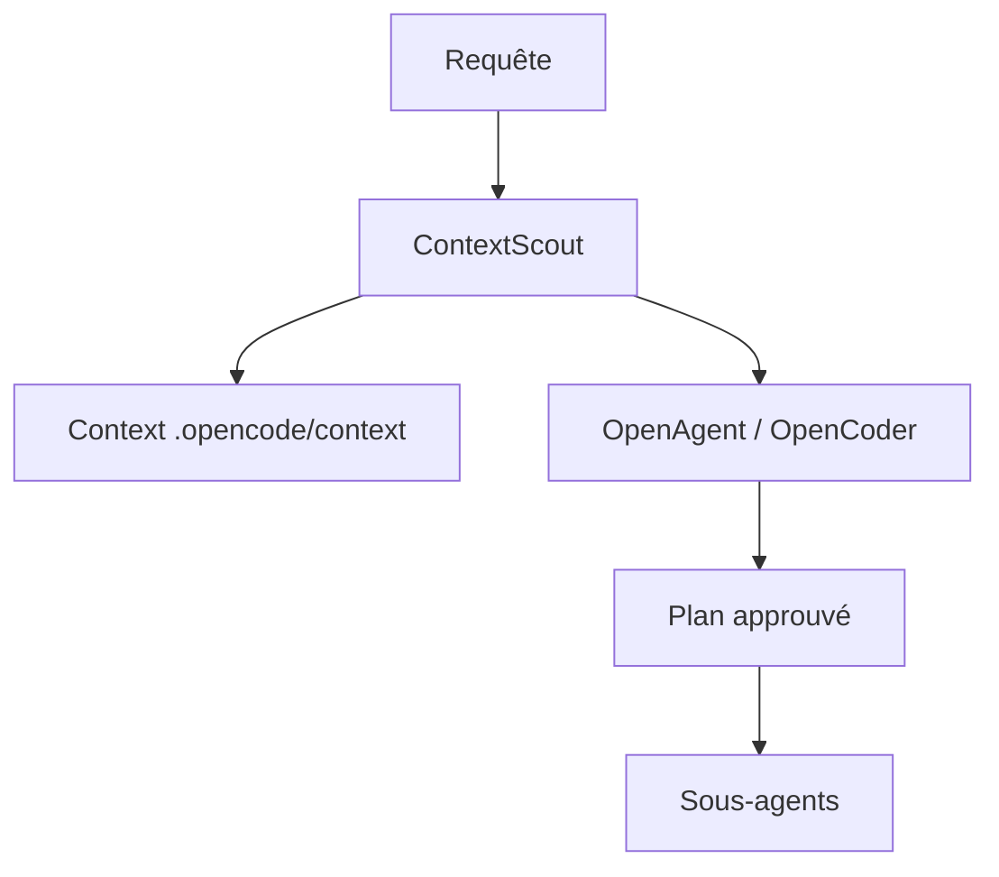

# darrenhinde/OpenAgents

> Coding agents for OpenCode that learn your conventions and ask for your consent before acting.

## The problem
Agents generate generic code that then has to be rewritten to match the team's conventions.

## What it actually does
It adds agents (OpenAgent, OpenCoder, SystemBuilder) and sub-agents to OpenCode. ContextScout first loads the project's conventions from `.opencode/context/`, the agent proposes a plan, you approve, then it executes step by step. The agents are editable markdown files. A plugin version for Claude Code exists in beta. README truncated in the source.

## How it is wired
Simplified diagram based on the sheet, no diagram provided.


## Trying it
```bash
curl -fsSL https://raw.githubusercontent.com/darrenhinde/OpenAgentsControl/main/install.sh | bash -s developer
opencode --agent OpenAgent
/plugin marketplace add darrenhinde/OpenAgentsControl
```

## Cost and gotchas
Requires the OpenCode CLI and a model at your expense. Adding conventions: 10 to 15 minutes. The README announces a complete overhaul to come.

## What it is not
Not autonomous: manual approvals slow the work down. No parallelism, and the 80% token saving is a claim by the authors.

## Alternatives
Oh My OpenCode: autonomous execution and parallel agents, faster. Aider: simple file edits. Cursor/Copilot: quick prototypes.

## For you
Worth watching: the idea of versioned context in the repository is good, but an announced overhaul makes adoption risky.
