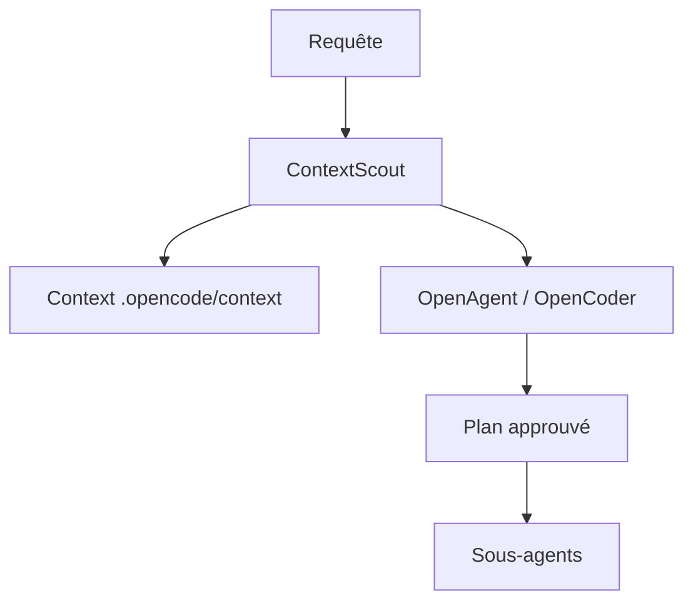

# darrenhinde/OpenAgents

> Agents de code pour OpenCode qui apprennent tes conventions et demandent ton accord avant d'agir.

## Le problème
Les agents génèrent du code générique que l'on doit ensuite réécrire pour coller aux conventions de l'équipe.

## Ce que ça fait vraiment
Il ajoute à OpenCode des agents (OpenAgent, OpenCoder, SystemBuilder) et des sous-agents. ContextScout charge d'abord les conventions du projet depuis `.opencode/context/`, l'agent propose un plan, tu approuves, puis il exécute étape par étape. Les agents sont des fichiers markdown éditables. Une version plugin pour Claude Code existe en bêta. README tronqué dans la source.

## Comment c'est branché
Schéma simplifié d'après la fiche, sans diagramme fourni.


## Essayer
```bash
curl -fsSL https://raw.githubusercontent.com/darrenhinde/OpenAgentsControl/main/install.sh | bash -s developer
opencode --agent OpenAgent
/plugin marketplace add darrenhinde/OpenAgentsControl
```

## Coût et pièges
Nécessite le CLI OpenCode et un modèle à ta charge. Ajout des conventions : 10 à 15 minutes. Le README annonce une refonte complète à venir.

## Ce que ce n'est pas
Pas autonome : les validations manuelles ralentissent le travail. Pas de parallélisme, et l'économie de 80 % de jetons est une affirmation des auteurs.

## Alternatives
Oh My OpenCode : exécution autonome et agents en parallèle, plus rapide. Aider : modifications de fichiers simples. Cursor/Copilot : prototypes rapides.

## Pour toi
À surveiller : l'idée de contexte versionné dans le dépôt est bonne, mais une refonte annoncée rend l'adoption risquée.

