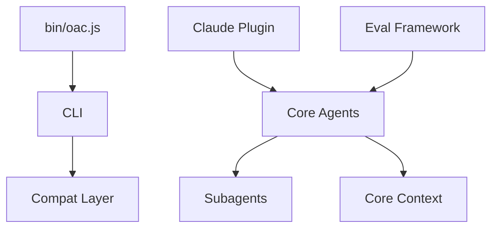

# darrenhinde/OpenAgentsControl

> Control layer for OpenCode: agents that follow your conventions and wait for your approval.

## The problem
AI-generated code ignores project conventions, leading to hours of rewriting and wasted tokens.

## What it actually does
Monorepo where behavior is mostly in markdown and JSON: agents and sub-agents (.opencode/agent), per-domain context (.opencode/context), commands and skills. A CLI (packages/cli, bin/oac.js) installs and updates, a compatibility layer translates to Claude, Cursor and Windsurf, and evals/ tests approval and delegation.

## How it is wired


## Trying it
```bash
curl -fsSL https://raw.githubusercontent.com/darrenhinde/OpenAgentsControl/main/install.sh | bash -s developer
opencode --agent OpenCoder
/add-context
```

## Cost and gotchas
OpenCode CLI required and a paid model at your expense. The Claude Code plugin is in beta. A major overhaul is announced.

## What it is not
Not an autonomous agent: approval is mandatory for every write. Not a compiled framework: it is editable configuration.

## Alternatives
Oh My OpenCode: autonomous, parallel execution. Aider: simple file editing. Cursor/Copilot: quick prototypes.

## For you
Worth watching: approvals and shared context suit a team, but the announced overhaul suggests waiting.
