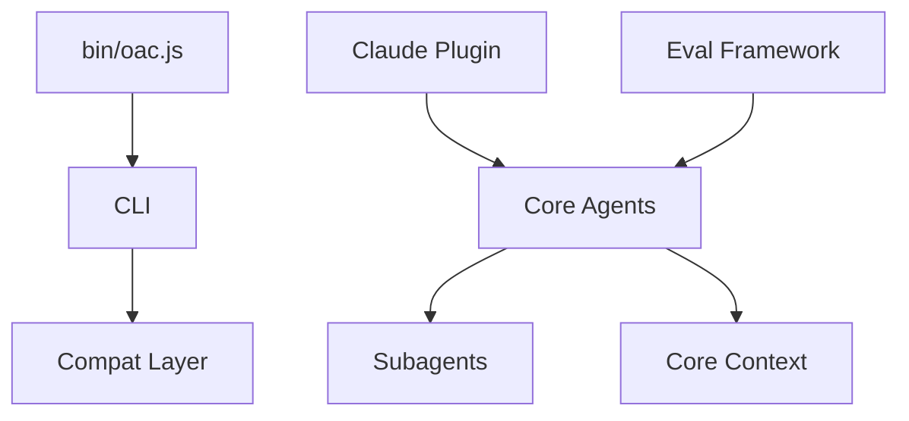

# darrenhinde/OpenAgentsControl

> Couche de contrôle pour OpenCode : agents qui suivent tes conventions et attendent ton approbation.

## Le problème
Le code généré par IA ignore les conventions du projet, d'où des heures de réécriture et de jetons gaspillés.

## Ce que ça fait vraiment
Monorepo où le comportement est surtout en markdown et JSON : agents et sous-agents (.opencode/agent), contexte par domaine (.opencode/context), commandes et compétences. Un CLI (packages/cli, bin/oac.js) installe et met à jour, une couche de compatibilité traduit vers Claude, Cursor et Windsurf, et evals/ teste l'approbation et la délégation.

## Comment c'est branché


## Essayer
```bash
curl -fsSL https://raw.githubusercontent.com/darrenhinde/OpenAgentsControl/main/install.sh | bash -s developer
opencode --agent OpenCoder
/add-context
```

## Coût et pièges
CLI OpenCode requis et modèle payant à ta charge. Le plugin Claude Code est en bêta. Une refonte majeure est annoncée.

## Ce que ce n'est pas
Pas un agent autonome : l'approbation est obligatoire à chaque écriture. Pas un framework compilé : c'est de la configuration éditable.

## Alternatives
Oh My OpenCode : exécution autonome et parallèle. Aider : édition de fichiers simple. Cursor/Copilot : prototypes rapides.

## Pour toi
À surveiller : approbations et contexte partagé conviennent à une équipe, mais la refonte annoncée incite à attendre.

