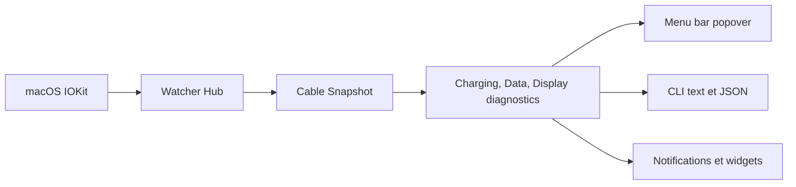

# darrylmorley/whatcable

> Small macOS menu bar app that tells you what each USB-C cable can do.

## The problem
Identical-looking USB-C cables can range from a simple USB 2.0 charging cable to 240 W Thunderbolt, and you don't know why the Mac charges slowly.

## What it actually does
Reads port state via IOKit, with no entitlement or private API: the cable's e-marker chips, the charger's power profiles, connected devices, the Thunderbolt link. It shows a plain-language verdict ("Cable is limiting charging speed"), trust signals on unusual values and a database of known cables. A `whatcable` CLI (JSON, watch, raw) is provided. A paid Pro tier adds cable history, a power monitor and a terminal dashboard.

## How it is wired


## Trying it
```bash
brew install --cask darrylmorley/whatcable/whatcable
brew install darrylmorley/whatcable/whatcable-cli
whatcable --json
whatcable --watch
```

## Cost and gotchas
Free; Pro is paid as a one-time purchase, on two Macs at most. Apple Silicon and macOS 14 minimum, because Intel Macs lack PD data. Nothing is sent automatically; only an update check every six hours and sending diagnostics on click exist.

## What it is not
Software cannot verify the actual wiring: if the e-marker chip lies, WhatCable won't detect it. The core diagnostic is not intended for ports without a controller (front ports of Mac mini/Studio).

## Alternatives
The README names WhatBattery (battery health) and WhatPort (all ports), by the same author, as complements; usbeehive for Linux.

## For you
Ignore: macOS hardware diagnostic unrelated to data or AI; young repo (May 2026) with an unidentified license.
