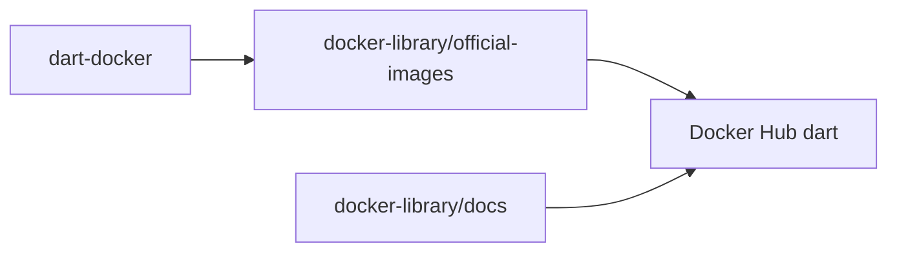

# dart-lang/dart-docker

> Git repository of the official Docker images for the Dart language, for Dart developers.

## The problem
Getting a reproducible Dart environment in a container without building the image yourself.

## What it actually does
The README is minimal: it states that the repository holds the source of the "Docker Official Images" for Dart and points to the Docker Hub page for usage. The content of the images is not described here.

## How it is wired
Simplified diagram based on the sheet, no diagram provided.

## Trying it
No command documented in the README. See the Docker Hub page.

## Cost and gotchas
Docker required. Usage instructions and issues are handled elsewhere, on Docker Hub.

## What it is not
It is not the Dart SDK nor a tool: it is the image definitions. Little material to judge it further.

## Alternatives
No alternative named in the README.

## For you
Ignore: useful only for containerizing Dart, outside your data, AI or MLOps scope.
